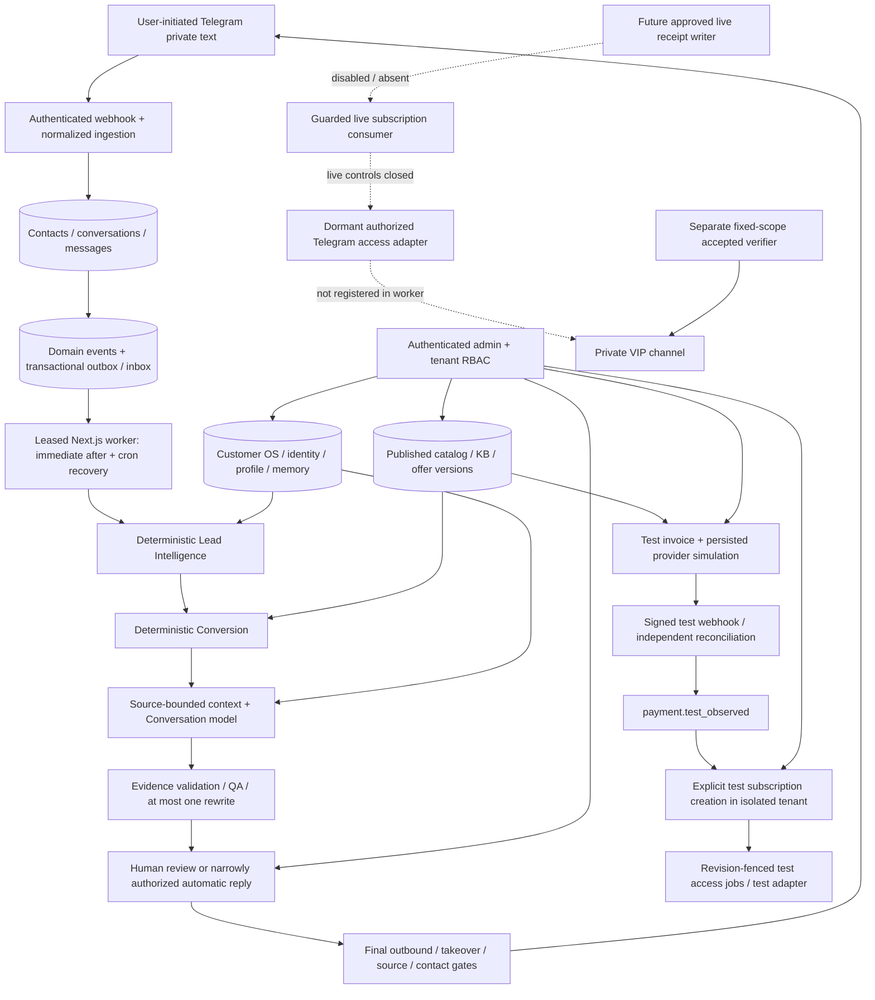

# GOLD REVENUE OS PRO — Master Product Context

Living continuation index, based on repository discovery on **2026-10-16 UTC**. Subsequent explicit owner authorization permits documentation publication/merge with exact-branch Preview suppression, then Phase 12 implementation and controlled isolated-staging acceptance. Phase 13+ and live production operations remain unauthorized. Owner: **Muhammed Alişan Gül**. Repository: [AlisanMedia/GOLD-REVENUE-OS-PRO](https://github.com/AlisanMedia/GOLD-REVENUE-OS-PRO).

This document connects product intent to implemented behavior and retained evidence. It does not authorize implementation, deployment, provider calls or commercial activation. Proposed work is tracked once in [NEXT_EXECUTION_BACKLOG.md](NEXT_EXECUTION_BACKLOG.md).

## 1. Product identity and commercial purpose

Gold Revenue OS is a centrally controlled, provider-neutral revenue operating system. Its first use case is multilingual sales/support for Telegram trading communities and membership subscriptions. The longer-term platform should support multiple authorized brands, suppliers, products and subscription businesses beyond trading.

The business lifecycle is acquisition → identity/qualification → conversation → approved offer → verified payment → subscription → access → retention/renewal → expansion. The existing investment covers the customer, conversation, commercial and deterministic entitlement foundations. It is **staging-accepted infrastructure, not a commercially activated production service**.

Revenue is expected from authorized service/membership sales, renewals and eventually additional products or partnerships. Supplier licensing/resale rights, actual trading claims, merchant eligibility and applicable financial marketing/consumer rules are unresolved business inputs. A product's `service_rights` field records a declaration; it does not independently establish a legal license. No revenue, profitability, supplier approval or verified trading performance is asserted here.

## 2. Evidence policy and verified repository snapshot

Use separate evidence for separate questions:

- **Authorization:** latest explicit owner scope and accepted closeout determine what may happen. Neither code presence nor roadmap text grants authority.
- **Behavior:** current code, ordered migrations and executed tests establish implementation. The immutable initial design describes intended features, including future ones.
- **Acceptance:** exact-SHA CI/jobs, retained artifacts, provider evidence and owner verdict establish only their recorded scope. Historical failures remain failures.
- **Environment:** old staging counts/flags are timestamped observations, not a fresh runtime inspection. This discovery did not query or change hosted customer/payment/access state.

| Read-only verification on 2026-10-16 | Result / canonical evidence |
| --- | --- |
| Remote `main` via Git and GitHub branch API | `7b5b2050875c4f611cd61aa1f2e1ea7762790835` |
| Latest merged PRs | [#88](https://github.com/AlisanMedia/GOLD-REVENUE-OS-PRO/pull/88) closeout → `7b5b205…`; [#87](https://github.com/AlisanMedia/GOLD-REVENUE-OS-PRO/pull/87) isolated verifier → `3a04630…`; [#86](https://github.com/AlisanMedia/GOLD-REVENUE-OS-PRO/pull/86) application → `68a4357…`; [#85](https://github.com/AlisanMedia/GOLD-REVENUE-OS-PRO/pull/85) Phase 10 closeout; [#84](https://github.com/AlisanMedia/GOLD-REVENUE-OS-PRO/pull/84) verifier CLI correction |
| Current-main CI | [38876903925](https://github.com/AlisanMedia/GOLD-REVENUE-OS-PRO/actions/runs/38876903925), completed/success; Application job `116894018251`, Database job `116894017896`, both success. Downloaded current-main Application logs show **519 unit + 93 integration** passed; the five verifier tests added after application acceptance explain the difference from the accepted application's 88 integration tests. |
| Legacy combined status | `pending`, zero statuses; not used as proof of success |
| Open issues / PRs | Issue search returned zero open issues. Pulls API returned 12 open PRs: historical Phase 7 reports #34/#53 and dependency PRs #1–6, #8–9, #20–21. They were not closed or merged. |
| Repository governance | Branch API `protected=false`; rulesets API returned `[]`. Required checks are documented but not enforced by observed branch protection/rulesets. Repository is public. |
| Tree / agent hierarchy | Recursive Git tree was not truncated. Root `AGENTS.md`, `apps/web/AGENTS.md` and the immutable build-pack `AGENTS.md` exist; nested files remain unchanged. No pre-existing master context/backlog file was found. |

Recheck remote main before subsequent work; this SHA is a dated baseline, not a permanent HEAD assertion.

### Phase 11 acceptance independently inspected

The accepted application is `68a4357bd9183a6977a71d98b1dffd76791c777c`; isolated verifier source is `3a04630a579eb4e327cdd29896741a30df2b5916`. Formal closeout is PR #88, merged at the current baseline. [PHASE_11_REPORT.md](../PHASE_11_REPORT.md) remains the detailed acceptance record.

| Evidence read during discovery | Observed result |
| --- | --- |
| Application-main CI [38481087604](https://github.com/AlisanMedia/GOLD-REVENUE-OS-PRO/actions/runs/38481087604) | Both jobs success at accepted app SHA. Downloaded Application job logs show **519 unit + 88 integration** tests passed; Database logs show **64 Phase 11 pgTAP** assertions passed, alongside existing suites. These are historical executed results, not newly rerun tests. |
| Controlled staging [38481471227](https://github.com/AlisanMedia/GOLD-REVENUE-OS-PRO/actions/runs/38481471227) | Both staging jobs success at accepted app SHA. Downloaded artifact `11858580031`: **32 checks, all PASS**, cleanup verified; no real payment/access effect. ZIP SHA-256 `4a51fc29129d2c57d68481fb438c0b17c252be05096269fe57579159d488efce`. |
| Telegram cycle [38856769865](https://github.com/AlisanMedia/GOLD-REVENUE-OS-PRO/actions/runs/38856769865) | Downloaded artifact `12026974106`: `API_CYCLE_PASS_AWAITING_ADMIN_PROMOTION`, two invite/join/revoke cycles, two ban/unban sequences, restored membership. **58 unsuccessful** early approval calls and two successful approvals. Cleanup: zero outstanding invites, no pending ban, no cleanup errors. ZIP hash matches closeout: `fd4942bcadaf51264fe7aab03e9bf6daf60a5a315147de16b7075dd2ba75b7aa`. |
| Final administrator read-back [38857650675](https://github.com/AlisanMedia/GOLD-REVENUE-OS-PRO/actions/runs/38857650675) | Downloaded artifact `12027364522`: `ADMIN_STATUS_VERIFIED`; owner creator, bot invite/restrict administrator, representative administrator after owner's promotion. ZIP hash matches closeout: `3e440c460fcc112cfcb4474b20e5f6da97a636db651a9004d2c5b61464517319`. |
| Earlier preflight [38650335969](https://github.com/AlisanMedia/GOLD-REVENUE-OS-PRO/actions/runs/38650335969) | Run/job failure remains failure; closeout attributes it to `getChat` 400 before usable private-channel access. |

The staging artifact originally says real Telegram testing was not yet run; the later separate verifier resolves that historical gate without changing the artifact. Neither verifies an integrated live merchant → production entitlement flow. Invite expiry was configured, not passively awaited. No Telegram test was repeated during discovery. Raw artifacts/logs were kept outside the repository; no invitation URLs or credentials belong in this document. GitHub artifacts have 14-day retention, so links may later expire; preserve approved sanitized evidence before expiry.

## 3. Phase state and development history

| Phase | Implemented responsibility | Exact reported checkpoint / status |
| --- | --- | --- |
| 0 | Repository audit, target architecture, gap analysis, amendments | [phase-0](phase-0/REPO_AUDIT.md), [ADR-002](adr/ADR_002_PHASE_0_APPROVAL_AMENDMENTS.md) |
| 1 | Monorepo, auth, tenant/RBAC, immutable audit, environment contracts, CI, admin shell | `49f0c8190e7d1ec794ab01e02b90a98741e6838d`; [cloud validation complete](../PHASE_1_VALIDATION_REPORT.md), [implementation report](phases/PHASE_1_REPORT.md) |
| 2 | Customer OS, identities/profile/memory/history, bounded imports/dedup, Customer 360 | `4763f7ce3b12fe498d1dd7d57d7d1cabf377f05c`; [implementation + staging report](../PHASE_2_REPORT.md); later dry-run hardening. Real import not executed. |
| 3 | Guarded state transitions, events, transactional outbox/inbox, retries, scheduled-job primitives | `64e8d6cfaabc56c2b94bdb05b7a16898841a9f46`; [COMPLETE — CLOUD VALIDATED](../PHASE_3_REPORT.md) |
| 4 | Role-aware operations dashboard, filters, Customer 360, attention/events/audit/health | `d9ab97b693d99eb0635b9f5346b1a9c9c465fdd4`; [COMPLETE — CLOUD VALIDATED](../PHASE_4_REPORT.md) |
| 5 | Provider-neutral text gateway, Telegram webhook/manual send/contactability, kill switch | `31edd760beab6bf4d3134557310b18ac674325f1`; [implemented and cloud-validated](../PHASE_5_REPORT.md), real restricted messaging evidence |
| 6 | Versioned agents/tasks/runs, safe tool contracts, context, mock provider, durable worker/review/telemetry | `dab00cf279c95ef63e85d48a972228e5972e50b9`; [implemented and cloud-validated](../PHASE_6_REPORT.md); initial merge `cf36d04…` |
| 7 | Real model, source-grounded multilingual conversation, director/render/QA, controlled auto replies | **CLOSED**, 2026-10-12; app `4cd5b2eecff4068b37778882fe8b434c31521626`; [report](../PHASE_7_REPORT.md) |
| 8 | Deterministic orchestration, provenance-bearing qualification and next action | **CLOSED**, 2026-10-12; app `17d497656dbe5c178fe6650fe8064de6ebe199c8`; [report](../PHASE_8_REPORT.md) |
| 9 | Products/plans/pricing, versioned KB, eligible recommendations and reviewed offers | **CLOSED**, 2026-10-12; app `ee6d25ba86934a6d889926c02d9f8cf56a0441b8`; [report](../PHASE_9_REPORT.md) |
| 10 | Provider-neutral Stars/independent-web crypto test payments | **CLOSED sandbox only**, 2026-10-13; app `031509dc3d447703954f9c76396a7ae8504a9213`; [report](../PHASE_10_REPORT.md) |
| 11 | Deterministic subscriptions, immutable paid periods, fenced access, isolated real Telegram staging proof | **CLOSED scoped staging**, 2026-10-16; acceptance ledger above |
| 12 | Human escalation cases, critical queue, operator notification and response ownership | **OWNER-AUTHORIZED** for isolated-staging implementation/acceptance; not yet implemented at this documentation checkpoint |
| 13 | Onboarding, support lifecycle, inactivity, renewal/churn/win-back messaging | Planned, **NOT AUTHORIZED / NOT STARTED** |
| 14 | Surveys, feedback taxonomy, insights and recommendation queue | Planned, **NOT AUTHORIZED / NOT STARTED** |
| 15 | Funnel/cohort/MRR/churn/cost and agent analytics | Planned, **NOT AUTHORIZED / NOT STARTED** |
| 16 | Controlled pilot, 10 → 25 → 50 → 100, each scale gate owner-approved | Planned, **NOT AUTHORIZED / NOT STARTED** |

The original [roadmap](source-of-truth/v1.0.0/IMPLEMENTATION_ROADMAP.md) also places hardening in Phase 17 and white-label in Phase 18. Critical production controls cannot be postponed merely because the roadmap labels hardening later. No standalone Phase 12–16 implementation/acceptance reports exist in the inspected tree; their scope comes from that roadmap and [manual dependencies](../MANUAL_ACTIONS_ROADMAP.md).

Phases 1–6 are reconstructed using their own implementation/validation wording. Some reports still end with the next phase blocked; those are historical checkpoints, not a reason to undo subsequent accepted work. This index does not invent separate formal owner-closeout evidence for every early phase or independently revalidate their old run artifacts. The owner's continuation scope accepts their documented boundaries.

## 4. Users, customer types and control ownership

| Role / actor | Current authority and limits |
| --- | --- |
| Owner | Commercial/legal policies, phase/activation approvals, infrastructure spend, channel governance; application role is separate from Telegram creator status. |
| `super_admin`, `manager` | Broad tenant operations, commercial editing/publication, test-payment actions, subscription controls; sensitive RPCs independently recheck roles. Import execution remains revoked even for authenticated super admins. |
| `support` | Customer identities, conversations/manual reply, agent review, read commercial/payment/entitlement evidence; no financial authority or entitlement management. |
| `analyst` | Customer/operational projections and commercial/payment/entitlement reads; restricted identity visibility; no send/review/control authority. |
| `readonly` | Dashboard and restricted customer list/detail; no payment/entitlement operations. |
| Agent / worker | AI proposes constrained language/tools. Server-owned deterministic worker/RPCs execute allowed operations; no model-controlled SQL/HTTP/shell or money/access authority. |
| Unmatched Telegram contact | Conversation/contact evidence exists without a canonical customer ID. Username never silently establishes customer identity. |
| Matched lead / test subscriber / eventual paying customer | Canonical tenant customer with validated linkage; simulated and live financial/entitlement authority remain distinct. No public customer account/checkout portal is established by admin previews. |

Current capability definitions: [permissions.ts](../apps/web/src/lib/admin/permissions.ts). Current tenant selection uses the first active membership in [admin/server.ts](../apps/web/src/lib/admin/server.ts), with no tenant switcher. Customer `assigned_manager_id` and filters exist; a complete team provisioning/assignment-rules/partner administration workflow was not found. Tenant is the implemented isolation unit; a separate multi-brand/supplier hierarchy is future design.

## 5. Actual architecture and component communication

One pnpm monorepo, one Next.js application, shared TypeScript modules and Supabase Postgres/Auth form a **modular monolith**. The durable queue is PostgreSQL, not Redis/BullMQ. [ADR-003](adr/ADR_003_POSTGRES_TRANSACTIONAL_OUTBOX.md) supersedes the initial external-queue proposal.

The verifier proves restricted provider behavior independently of the deployed subscription worker. The test-payment event is not automatically promoted to financial authority. `admin_create_test_subscription` explicitly consumes it in an outbound-disabled `phase11-sandbox-*` tenant.

### Stack and infrastructure actually represented

- Next.js **16.3.8**, React/React DOM **19.2.8**, TypeScript **5.9.3**, Zod **4.6.2**, Tailwind **4.3.3**; exact dependencies in [web package](../apps/web/package.json) and [pnpm lockfile](../pnpm-lock.yaml).
- Node **24.19.0**, pnpm **11.19.0**, Supabase CLI **2.117.0**, Vitest **5.0.0** in the pinned CI path. Historical reports' Next.js 16.3.5 describes earlier releases.
- [packages/config](../packages/config/src/index.ts): environment contracts; [contracts](../packages/contracts/src/index.ts): API/role types; [domain](../packages/domain/src/index.ts): pure policies/classification/date/QA logic; [observability](../packages/observability/src/index.ts): redacted Pino primitives.
- Supabase staging `gold-revenue-os-staging`, ref `xqvwkghpmezcpgugetqc`, region `eu-central-1`; Auth signup disabled in configured local stack. Production MFA, retention, backups/restore and identity policy need separate readiness evidence.
- Vercel staging team/project `gold-revenue-os-staging`; the isolated project's **production target** is used for cron support. This is not Gold Revenue OS production authorization. A read-only project lookup confirmed SSO deployment protection and existing latest Preview; it did not verify current canonical runtime state.
- OpenAI Responses adapter is implemented and has Phase 7/9 accepted staging evidence. Deterministic Lead/Conversion tasks do not make separate paid model calls. No new provider/model was activated in discovery.
- GitHub Actions [CI](../.github/workflows/ci.yml) has independent Application/Database jobs; [staging](../.github/workflows/staging.yml) and [Telegram verifier](../.github/workflows/phase11-telegram-acceptance.yml) are manual workflows. No new dispatch occurred.
- No runtime Redis, external queue, vector database, additional microservice or newly purchased service is justified by current evidence. The import parser works in memory; a private import bucket remains a proposal, not deployed storage evidence.

## 6. Implementation inventory and data ownership

| Module / business contribution | Current implementation and owned data | Inputs → outputs / main code evidence |
| --- | --- | --- |
| Auth/tenant/admin control | Supabase sessions, `app_users`, `tenants`, `tenant_members`, settings/audit; server capabilities plus DB role checks | Authenticated identity → active tenant/role; [auth/context.ts](../apps/web/src/lib/auth/context.ts), [foundation migration](../supabase/migrations/202609120001_foundation.sql) |
| Customer OS / relationship ownership | Customers, normalized identities, profile/field metadata, provenance-bearing memory, state history; conservative duplicates and unmatched contacts | Authorized records/reviewed identities → Customer 360; [customer-os.ts](../packages/domain/src/customer-os.ts), [Customer DAL](../apps/web/src/lib/customer-os/server.ts), [migration](../supabase/migrations/202609150002_customer_os.sql) |
| Historical import | CSV/XLSX bounded parsing, dry-run, exact/probable/ambiguous/new classification, review UI; real commit LOCKED | Authenticated bounded file → review metadata; no authorized historical ingestion now; [readiness gate](../PHASE_2_IMPORT_READINESS.md), [parser](../apps/web/src/lib/customer-os/import-parser.ts) |
| Lifecycle / event authority | Expected-state transitions, guarded matrix, immutable event/history/attempts, outbox/inbox, scheduled jobs | Valid actor/event/idempotency → atomic state + event + audit; [state-event domain](../packages/domain/src/state-event-engine.ts), [migration](../supabase/migrations/202609160002_state_event_engine.sql) |
| Messaging | Private text ingestion, `/start`, conservative identity binding, manual/controlled auto send, contactability, provider attempts, kill switch | Authenticated Telegram update → normalized message/event; approved queued reply → actual provider acknowledgment; [webhook](../apps/web/src/app/api/webhooks/telegram/route.ts), [dispatch](../apps/web/src/lib/messaging/outbound-dispatch.ts) |
| Agent runtime / orchestration | Versioned prompts/configs, tasks/runs/attempts, schema validation, leases/retry/dead-letter, tool proposals/review, model invocations/heartbeat | Fresh allowed event → specialist tasks then one reply producer; [worker](../apps/web/src/lib/agent-runtime/worker.ts), [Phase 8 migration](../supabase/migrations/20261012030719_phase8_orchestrator_lead_intelligence.sql) |
| Conversation Quality | Style/director/renderer/QA, bounded source context, opaque evidence handles, memory provenance, exact action receipts, human hold | Source-bound messages + approved facts → truthful EN/TR/AR/RU draft, one rewrite maximum, approve/hold; [context builder](../apps/web/src/lib/agent-runtime/context-builder.ts), [quality](../packages/domain/src/conversation-quality.ts), [evidence](../packages/domain/src/conversation-evidence.ts) |
| Lead Intelligence | 13 qualification categories with explicit/system/inferred/unknown provenance, completeness, one-question/question-first recommendation; conversation-scoped if unmatched | Inbound self-report + current control state → persisted qualification/recommendation; [lead-intelligence.ts](../packages/domain/src/lead-intelligence.ts). Completeness is **not** lead score or conversion probability. EN/TR extraction is conservative; broad multilingual extraction/scoring is not implemented. |
| Product/pricing/KB | `commercial_items`, immutable versions, approval/publication/archive/history; exact amount/currency/duration, trial/eligibility/discount/terms, ten KB categories | Admin-approved facts → time/tenant/locale-scoped retrieval; [commercial domain](../packages/domain/src/commercial.ts), [migration](../supabase/migrations/20261012102900_phase9_commercial_catalog_knowledge_conversion.sql), [admin](../apps/web/src/lib/commercial/admin.ts) |
| Conversion | Deterministic eligible recommendation, reviewed offer snapshots, approved objection text, deduplicated review-only follow-up | Valid published catalog + qualification → answer/recommend/prepare offer/review; same commercial domain and worker. No automatic trial entitlement, follow-up send, invoice or commercial-policy override. |
| Payments | Two **test** adapters; immutable invoice/quote/rules snapshot, exact atomic units, provider observations/transaction uniqueness, HMAC/replay/idempotency and independent simulation reconciliation | Approved offer + explicit test quote → test invoice; authenticated observation → test state/event; [adapters](../apps/web/src/lib/payments/adapters.ts), [service](../apps/web/src/lib/payments/service.ts), [migration](../supabase/migrations/20261013142417_phase10_multi_channel_test_payments.sql). Genuine Stars verification contract is [unmounted](../apps/web/src/lib/payments/telegram-evidence.ts); live crypto merchant/writer absent. |
| Subscriptions | Guarded live consumer plus isolated test creation, immutable payment periods/terms, UTC calendar expiry, renewals, holds/suspend/cancel/revision/audit | Valid same-tenant approved offer + appropriate payment authority → period and entitlement; [subscriptions.ts](../packages/domain/src/subscriptions.ts), [Phase 11 migration](../supabase/migrations/20261013222720_phase11_subscription_access.sql). Renewal timing does not charge or send reminders. |
| Telegram access | Verified numeric binding/channel, temporary approval-required links, leased revision-fenced jobs, join validation/reconcile/revoke/retry; deployed service is **test-only** | Current entitlement + verified identity + approved channel → controlled job/evidence; [adapter](../apps/web/src/lib/entitlements/adapter.ts), [service](../apps/web/src/lib/entitlements/service.ts), [separate verifier](../scripts/phase11-telegram-acceptance.mjs) |
| Retention/escalation/intelligence | Human takeover, QA escalation recommendation/blocking, attention diagnostics, renewal-due/expiry primitives already exist | Full case assignment/notification/SLA, lifecycle outreach, surveys and aggregate feedback intelligence remain Phase 12–14 proposals. |
| BI / economics | Operational counts, customer-state distribution, queue/heartbeat, proposal QA/review ratios, latency/tokens and nullable provider billing fields | Read models / invocation evidence → operations visibility; [dashboard DAL](../apps/web/src/lib/admin/server.ts), [quality page](../apps/web/src/app/admin/agent-quality/page.tsx). Revenue BI/MRR/CAC/LTV/churn/profitability are not implemented. |

Financial, entitlement and customer lifecycle records are separate authorities; a lifecycle label alone is not proof of paid entitlement. `payment.test_observed` can never substitute for `payment.confirmed`. No agent can create a verified receipt or override commercial eligibility.

## 7. Core operating workflows

1. **Acquisition and identity:** implemented Telegram entry is user-initiated private text, not automated advertising or cold outreach. The gateway authenticates its configured tenant/provider, normalizes and deduplicates updates. Numeric identity may match exactly; ambiguous/username-only identity remains unlinked. Customer creation/import is a separately controlled Customer OS process.
2. **Qualification and conversation:** event/outbox → deterministic specialist routing → Lead → Conversion → Conversation. Context ends at the triggering source message; future or ambiguous evidence is excluded. Customer questions take precedence over discovery. Missing facts remain unknown. Only the conversation path proposes a customer reply.
3. **Offer:** currently valid published catalog/KB and supported qualification determine eligible plans. Offers preserve commercial versions, approved amounts and bounded discount authority. Review/approval does not mean sent, paid or activated. Phase 9 fixture prices were archived and are not real public pricing.
4. **Sandbox purchase:** authorized admin test invoice → persisted test provider snapshot → timestamped HMAC observation/reconciliation → `payment.test_observed`. Test subscriptions require an isolated outbound-disabled Phase 11 tenant and explicit test consumer. No real wallet, payable link, Stars invoice send or production access is created.
5. **Future live purchase (blocked):** separately approved genuine provider evidence/writer → immutable verified receipt + trusted event → closed-by-default subscription consumer → current entitlement → verified numeric binding/private channel → fenced job → observed membership → guarded lifecycle transition. The writer, mounted live payment flow and production adapter registration are absent/disabled. This is an activation design boundary, not an already working merchant journey.
6. **Renew/expire/recover:** a valid new payment period extends from `max(now, prior end)` using calendar-month/year clamping or exact UTC days. Holds/cancellation/expiry invalidate older revisions and queue revocation; stale completions cannot reactivate current access. Reconciliation detects mismatches. Retry and incident recovery must preserve evidence; no automatic refunds, recurring collection or retention campaigns are implied.

## 8. Administrative surface map

| Existing route group | Implemented surface / material limit |
| --- | --- |
| `/login`, `/auth/callback`, `/access-pending`, `/admin` | Auth/session/membership boundary and operational dashboard; no tenant switch/team CRUD. Dashboard's payment/subscription-unimplemented caption is stale. |
| `/admin/customers`, `/admin/customers/[id]` | Filters, ownership field, Customer 360 identity/profile/memory/state/event/audit and entitlement evidence; bounded historical windows. |
| `/admin/imports`, `/new`, `/[id]` | Dry-run/reconciliation/review only; displayed import machinery does not unlock historical commit. |
| `/admin/conversations`, `/[id]` | Message history, permitted manual reply, takeover/control, per-conversation automatic-reply authorization, Lead/Conversion evidence. No separate lead-scoring dashboard is required to prove qualification exists. |
| `/admin/agents`, `/admin/agent-runs/[id]`, `/admin/agents/versions/[id]`, `/admin/agent-quality` | Tasks/runs/context/tool/model evidence, version visibility, approve/edit/reject and QA metrics. |
| `/admin/catalog`, `/new`, `/[id]`; `/admin/knowledge`, `/new`, `/[id]`; `/admin/offers` | Product/plan/KB draft/edit/preview/review/publish/archive/version history and reviewed offers. No live commercial activation is implied by publication capability. |
| `/admin/payments`, `/[id]` | TEST invoices, provider observations, reconciliation and gated simulation/preview actions. No live merchant checkout or refund execution. |
| `/admin/subscriptions`, `/[id]`; `/admin/channel-access` | Test subscriptions, payment periods, controls/history/journey preview and access jobs. `PurchaseStatus` is an admin-used presenter, not proof of a deployed customer self-service portal. |
| `/admin/attention`, `/events`, `/audit`, `/system` | Diagnostics, operational events, immutable audit and health; attention is not the full future escalation engine. |
| API health, customer/import/state/message APIs, webhook and worker routes | Server boundaries supporting the above; API existence is not public access. Role checks and RPC grants remain authoritative. |

## 9. Security restrictions and authority chain

- Tenant-scoped tables, composite tenant foreign keys, RLS and active membership checks; browser-supplied tenant IDs cannot grant access. Session lookup uses Supabase `getUser`; roles come from database membership, not editable user metadata.
- Authenticated business-table writes are restricted; privileged functions validate tenant/roles and fix `search_path`. SECURITY DEFINER is a deliberate boundary that needs grant/argument review. Service-role credentials bypass RLS and therefore require server-only code, tenant checks and isolated secrets.
- State/event/audit writes commit together. Audit, payment evidence, subscription payment periods and bindings preserve immutable evidence. Idempotency includes payload conflicts; claims use row locks/leases, current state and revision fencing.
- Telegram webhook secret, test-payment raw-body HMAC/timestamp/size checks, configured tenant/provider and bounded test windows precede effects. Screenshot/customer claim/browser callback/precheckout approval is never sufficient payment verification.
- Human takeover, paused state, contactability, tenant outbound kill switch, per-conversation authorization timestamp, source order, QA/current versions and scoped receipt checks precede automatic send. A provider-accepted in-flight send cannot be recalled by a later kill switch; uncertain delivery is not blindly retried.
- Model output and published KB text are untrusted input. Opaque backend evidence, source/time scope, schema/allowlists and database revalidation protect facts and completed-action claims. Raw invitations, credentials and financial control inputs do not enter AI context.
- Live payment receipt tables/enable controls cannot be written by runtime roles. Real Telegram adapter remains dormant. Historical import RPC execution was revoked from `authenticated` by the [Phase 4 migration](../supabase/migrations/20260917055834_phase4_admin_control_plane.sql).
- Historical import remains **LOCKED**: lawful permitted use, canonical file/hash, all **225** review records, reconciliation of **1,133–1,152** versus historical approximately **1,161**, second dry-run/final review report and new owner approval are prerequisites. Do not reopen supplied raw data during this handoff.
- Production activation, live payments, real-customer subscriptions/access changes, broad outbound, existing channel permission changes, new VIP invitations, historical replay and Phase 13+ remain unauthorized. The later owner instruction permits only Phase 12 isolated-staging implementation, controlled deployment and explicitly scoped sandbox/manager-notification acceptance. Discovery performed none of those runtime actions.

Accepted private staging identity scope: channel `-1003944824067`; bot `@gold_revenue_os_staging_bot` / `8673054837`; owner `@alisangul` / `6890052501`; representative `@polatfx` / `8327046095` (formerly `@tahirdonzfx`, same numeric user). These identify past acceptance, not permission for new operations. Do not change their roles automatically.

## 10. Failure modes, scaling limits and operational debt

| Boundary | Failure behavior / present limit | Engineering implication |
| --- | --- | --- |
| Identity/customer data | Unknown or conflicting identities stay unmatched; timeline/import limits are bounded | Preserve review, provenance and PII controls; a customer count is not a target to force merges. |
| Event/agent worker | Durable leases/retries/dead letters; cron recovery, one claimed agent task per invocation | Measure queue age/connection/write pressure before adding workers/queues. Immediate enabled conversation path attempts at most three sequential invocations and stops starting new work after 50 seconds. |
| Model/QA | Invalid evidence, unsupported claim or exhausted rewrite holds/fails; tokens/latency captured, billed cost may be null | EN/TR deterministic extraction and finite multilingual QA rules have known coverage limits. Expand from observed failures, not by weakening receipts. |
| Telegram sends | 429 can schedule retry; uncertain delivery cannot safely use blind retry | Reconcile operator-visible uncertainty; provider lacks idempotent send keys/read receipts. Text only, no arbitrary-username messaging/media pipeline. |
| Payment provider | Wrong amount/network/payer/finality, late/refund/reorg evidence → explicit failure/review; provider lookup failure preserves prior state | Live integration needs independently verified authority, reconciliation ownership, refund/support policies and outage procedure. Test state CONFIRMED is not revenue. |
| Subscription/access execution | Stale revision cannot update current state; provider failures back off and fail after bounded attempts | DB fencing cannot reverse a provider side effect already executed. Live failure/compensation and reconciliation require separate design/evidence. |
| Entitlement scheduling | `/api/cron/entitlements` exists but is absent from `vercel.json` cron list; registered agent worker does not call entitlement service | No repository-wired recurring entitlement cycle is demonstrated. Current route enumerates only isolated test tenants. Do not claim unattended live expiry/access maintenance. |
| Entitlement read model | `admin_entitlement_list` limits subscriptions to 100, but access/payments/jobs/audit aggregates are unbounded | Confirmed static query shape; response size/DB aggregation can grow. No production latency/load result is available. |
| Plan/channel model | One VIP channel per tenant/mode, one access per binding/channel; subscriptions keyed by customer + plan **version** + mode | Multi-brand/multi-channel and plan-version migration are future scope. A second plan-version subscription can hit access-scope review; same-version cancelled repurchase is rejected. Define policy before changing it. |
| Retention/incident response | Policy configuration exists, production durations undecided; no full case/notification/SLA engine | Do not equate stored retention settings or Needs Attention with enforced deletion or staffed response. |
| Release governance | `main` unprotected/no rulesets; CI required by procedure; feature-branch Git previews enabled by default | Documentation branch publication can trigger Preview even without staging workflow. #88 did so. Resolve suppression before publishing this continuation. |

Confirmed presentational defect: [admin/page.tsx](../apps/web/src/app/admin/page.tsx) says payment and subscription domains are not implemented, while their modules/routes exist. Revenue analytics remains unavailable; only the explanation is stale. It was not changed in this documentation-only handoff.

Retained Phase 11 follow-ups: owner review of excessive representative delete/restrict/story/video/DM permissions; replace 58 premature join-request approval polls with event-driven updates or bounded event-aware backoff. Accepted staging is not reopened by listing these items.

Historical advisories: leaked-password protection disabled, intentional authenticated SECURITY DEFINER warnings and default-deny heartbeat RLS INFO were recorded in Phase 8/9. They were not freshly rerun here and are not proof of an exploit. CI retains the exact `GHSA-vfj7-8cjw-p6xm` development-toolchain exception; reassess its current scope/fix before dependency updates. No blanket audit waiver is intended.

## 11. Commercial assumptions and launch dependencies

Before offering a real service, establish provider/reseller rights by supplier/product/territory and permitted use, verified service descriptions/performance evidence, financial promotion rules and required disclosures, consumer/refund/cancellation/renewal terms, privacy/retention/data residency and customer acquisition consent. Owner location, payment geography or merchant entity must not be inferred from language or repository metadata.

Telegram-origin digital purchases follow the accepted ADR-006 Stars boundary; crypto is independent web only. No Telegram redirection to external crypto checkout is authorized. Asset/network examples and fiat/Stars quote values in fixtures are not approved treasury policy, exchange rates or real pricing. Provider/KYB/custody/settlement/refund rules, chargeback/fraud handling and recurring-payment authority remain launch gates.

The manual-actions roadmap contains forecasts, not proof accounts/services were created. Do not provision production, purchase monitoring/queue/storage or connect new suppliers based on a roadmap row. Resolve product economics before scaling: supplier share, payment/network fees, support labor, AI/messaging/runtime/database costs, refunds, tax and renewal behavior. No unit-economics figure is available today.

## 12. Revenue intelligence: existing versus proposed

| Metric family | Exists today | Future requirement, not implemented analytics |
| --- | --- | --- |
| Operations | Customer-state counts, event/outbox failures/backlog, audit/import review, heartbeat | Alert routing/SLA and operational efficiency trends |
| AI quality/cost | Review/QA rates, failures, latency/tokens, provider/model IDs; billed fields nullable | Actual cost ledger, cost per resolved conversation/paid conversion, provider invoice reconciliation |
| Payments/subscriptions | TEST invoices/observations and immutable period/entitlement records | Genuine collected revenue, refunds/net revenue, recurring revenue/MRR and renewal rates with explicit definitions |
| Funnel/acquisition | Domain events/source references and qualification evidence | Consent-aware attribution, denominators, conversion probability calibration, conversion rates and CAC |
| Customer value | Canonical identities, lifecycle and period evidence | Cohorts, churn, LTV, reactivation/retention and upsell impact |
| Brand/product/partner economics | Tenant/catalog identifiers; no supplier settlement ledger | Revenue/cost attribution, contribution margin, net profit, provider/partner share, concentration by brand/product/provider |

Do not count simulations, approved offers, memberships without genuine receipts or duplicated renewals as real revenue. Prefer privacy-aware Postgres read models before a warehouse. Aggregate only after metric definitions, currency/refund rules and actual live authority exist.

## 13. Scaling strategy and strategic priorities

Preserve the modular monolith, provider adapters and transactional Postgres authority. Use measured outbox lag, oldest task age, failure/retry rates, DB connection/aggregation load, webhook response time, model latency/token usage and provider limits to decide capacity changes. The current one-task cron recovery rate is a design bound, not a measured throughput SLA.

Highest leverage is to turn blocked/review-only cases into safely owned human work, then make authorized subscription retention measurable. Extend the existing admin/customer/event evidence instead of building disconnected bots. Keep Lead/Conversion deterministic; optimize paid conversation context/model usage only against quality and cost evidence. Add brands via an explicit tenant/brand/entitlement decision, not by removing tenant constraints or copying customer data between brands.

Sequence: release/authorization safeguards and launch policy gates → separately authorized Phase 12 → Phase 13 → Phase 14/15 → explicitly bounded Phase 16 pilot. Payment live activation and production access are their own approval tracks, not side effects of Phase 12. Detailed dependency, complexity and verification gates are in the backlog.

## 14. Owner authorization requirements and next execution gate

The initial handoff authorized discovery, assessment and documentation only. The subsequent owner instruction additionally authorizes publication/merge with exact-branch Preview suppression and Phase 12 isolated-staging implementation/acceptance. Safe work includes code/document reads, sanitized evidence inspection, local documentation branch/edit/link checks and a documentation PR **only if it cannot deploy**. No paid model calls, Telegram operations, hosted business-data changes or phase implementation are needed for this handoff.

Decisions requiring explicit owner scope:

1. Safe PR publication mechanism: non-main Git previews currently default enabled. The owner explicitly approved adding only `docs/master-product-context-20261016: false` while preserving `main: false`; the first push must include this rule. No global settings or other branches may change in the documentation PR.
2. Main-branch protection/review policy, dependency PR handling, historical PR cleanup and repository visibility.
3. Phase 12 implementation is now authorized. Actual operator destinations, primary/backup staff, response windows and notification secrets still require owner-supplied setup; never assume the VIP channel or brand administrator is the notification recipient.
4. Scoped reliability/code changes listed in backlog, particularly access event/scheduler wiring and permission projection before live activation.
5. Legal suppliers/resale rights, jurisdictions, actual commercial facts/prices/terms, tax/refund/privacy/retention and permitted customer acquisition.
6. Live provider/merchant/asset/network/finality/custody/settlement, genuine receipt writer, refund workflow and controlled real-payment tests.
7. Production infrastructure/spend, credentials, backups/RPO/RTO/restore evidence, access channels/users/bot permissions and pilot scale.
8. Historical dataset lawful-use scope and final review; further Telegram acceptance/permissions changes or broad outbound/historical replay.

The next engineering phase is **authorized but not started at this documentation checkpoint**. Complete this documentation PR/CI/merge with approved publication suppression, then implement bounded Phase 12 with acceptance criteria. Phase 13+ remains unauthorized. A new session must verify current main again before acting.

## 15. Canonical sources, conflicts and maintenance

- [README](../README.md): current phase overview; [Phase 11 report](../PHASE_11_REPORT.md): accepted latest scope; [ADR-007](adr/ADR_007_PHASE11_FENCED_ENTITLEMENTS.md): subscription/access authority; [ADR-006](adr/ADR_006_PHASE10_MULTI_CHANNEL_PAYMENTS.md): channel-neutral payment policy; [ADR-003](adr/ADR_003_POSTGRES_TRANSACTIONAL_OUTBOX.md): actual queue decision.
- [Immutable v1.0.0 build pack](source-of-truth/v1.0.0/README.md), [system spec](source-of-truth/v1.0.0/SYSTEM_SPEC.md), [roadmap](source-of-truth/v1.0.0/IMPLEMENTATION_ROADMAP.md), [security](source-of-truth/v1.0.0/SECURITY_COMPLIANCE.md): original product intent. Do not edit its checksummed files or treat proposed tool names, Redis/BullMQ or future agents as deployed functionality.
- [Phase 8 design](phases/PHASE_8_DESIGN.md), [Phase 9 design](phases/PHASE_9_DESIGN.md), [Phase 10 design](phases/PHASE_10_DESIGN.md), [phase-7 corrections](phase-7/CORRECTIVE_DESIGN.md): rationale/history; read against later closeouts and actual migrations.
- [Manual-actions forecast](../MANUAL_ACTIONS_ROADMAP.md) is dated 2026-09-13: its Redis dependency is superseded by ADR-003, crypto-first wording by ADR-006, and later account-creation rows are not current instructions. Earlier reports' “Phase 11 not authorized” is historical and superseded by Phase 11's accepted scope; live restrictions persist.
- [Root AGENTS](../AGENTS.md): concise session rules; [web AGENTS](../apps/web/AGENTS.md): Next.js-specific nested instructions; original build-pack AGENTS describes product agents, not implementation authorization or permission to spawn agents.
- [Bootstrap](../infra/runbooks/bootstrap.md), [rollback](../infra/runbooks/rollback.md), [secrets](../infra/runbooks/secrets.md) are Phase 1-scoped runbooks. They do not constitute current production DR/key-rotation procedures. README's root `.env.example` copy instruction points to no tracked root file; the retained template is inside the build pack.

Handoff validation: 108 local Markdown links resolve, code fences are balanced, all 18 retained build-pack checksums match, and `git diff --check` passes. The original reviewed commit changes only root AGENTS and the two living documents; this authorized publication increment additionally changes the exact documentation-branch suppression in `vercel.json`. No new application/database test execution is claimed for these prose changes. The local documentation branch is prepared; remote publication/PR-head CI is pending execution of the now owner-approved safe Preview suppression (B00). Main was rechecked and remained at the stated baseline.

Maintain this index and the backlog when separately approved work changes behavior or scope. Link detailed phase evidence instead of copying histories. Keep actual outcomes, failures, unknowns and owner authorizations distinct. Never mark a phase closed solely because a PR merged.
