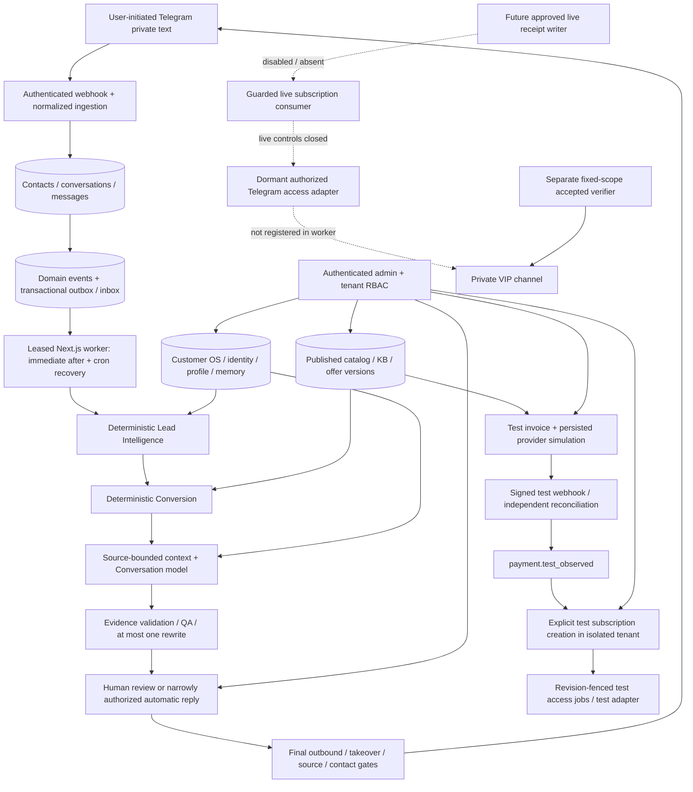

# GOLD REVENUE OS PRO — Master Product Context

Living continuation index, initially reconstructed on **2026-10-16 UTC** and updated after explicit owner-approved Phase 15 formal closeout on **2026-10-18**. Phases 1–15 are CLOSED only within their accepted implementation/sandbox/test boundaries; early phase validation evidence retains its original scope. Phase16 work is limited to explicit owner scope; genuine production/commercial activation remains unauthorized. Owner: **Muhammed Alişan Gül**. Repository: [AlisanMedia/GOLD-REVENUE-OS-PRO](https://github.com/AlisanMedia/GOLD-REVENUE-OS-PRO).

This document connects product intent to implemented behavior and retained evidence. It does not authorize implementation, deployment, provider calls or commercial activation. Proposed work is tracked once in [NEXT_EXECUTION_BACKLOG.md](NEXT_EXECUTION_BACKLOG.md).

## 31 Ekim 2026 — genuine campaign integration

[Native campaign runtime](../infra/runbooks/campaign-genuine-runtime.md) extends the
existing worker/context/Phase7 QA/shared PostgreSQL attempt journal and existing
Admin START/PAUSE/STOP. Independent account/custody and numeric Business controls
are unseeded, server-owned and distinct from private-beta grants. Local/CI external
network doubles are not genuine model, billing, Telegram or founder MFA acceptance.
Hosted56/56 acceptance40945906844 remains historical accepted evidence; the new
migration is not automatically applied hosted. Financial NONE and commercial NO_GO
remain until genuine payment/VIP and external commercial acceptance.

## 29 Ekim 2026 — tek kurucu kampanya aktivasyonu

Yeni owner scope tarihsel iletişim iznini `OWNER_ATTESTED_EXISTING_PERMISSION`
olarak toplu beyanla kaydetmeye, güvenli import alt kümesini uzlaştırmaya ve tek
START/PAUSE/STOP ile rutin QA/teklif/takip iç onaylarını birleştirmeye yetki verir.
Ayrı geliştirme-fazı kabulü veya1161 satır onayı aranmaz. Kurucu beyanı bireysel
bağımsız doğrulanmış rıza değildir; gerçek opt-out/platform/tenant/MFA ve finansal
kontroller korunur. İngilizce müşteri varsayılanı Admin dilinden bağımsızdır.
[Uygulama kaydı](../FOUNDER_CAMPAIGN_IMPLEMENTATION_REPORT.md) sentetik/native/PG
kanıtını ve eksik genuine kampanya yürütücüsü/account/transport bağını ayırır.
Gerçek liste/müşteri mesajı işlenmez. Önceki raporlar tarihsel kapsamını korur;
yeni protected CI/merge ve staging kanıtı son owner raporunda ayrıca doğrulanır.

## 27 Ekim 2026 — OpenAI ve seçili Polat özel sohbeti

Yeni owner seçimi OpenAI'dir. Tek scoped engineering package, eski Claude v1'i
koruyarak `gpt-6.1-sol` / version2 account-binding / native Phase7 QA ve aynı
PostgreSQL budget journal yolunu ekler. Yeni OpenAI notice/canary hash'leri ayrı;
genel OPENAI_MODEL değişmez. Mevcut OPENAI_API_KEY yalnız protected runtime
custody ve bağımsız account proof sonrasında kullanılabilir.

Telegram BUSINESS yolu exact representative + tek founder chat ile sınırlıdır;
her send öncesi fresh permissions, generation fencing, HUMAN_TAKEOVER, UNKNOWN
ve replay korumaları korunur. Kimlik discovery adayları public CI artifact'lerine
çıkarılmaz; private DB/fresh-MFA owner Admin read ve kısa validity kullanılır.
Adaylar veya Secretary Mode tek başına dispatch/consent authority değildir.

[OpenAI/BUSINESS implementation evidence](../POLAT_OPENAI_BUSINESS_UAT_IMPLEMENTATION_REPORT.md)
ve [release procedure](../infra/runbooks/private-beta-release.md). Offline/PG PASS
hosted veya genuine account/Telegram kabulü değildir.5.00USD total cap; owner'ın
18USD bakiye beyanı hard cap sayılmaz. Commercial NO_GO, financial NONE,
overall Phase16C-1 OPEN. Tarihsel Claude/fikstür kabulü aynen korunur.

## 26 Ekim 2026 — founder-authorized private-beta UAT program

The newer founder directive authorizes a bounded private beta, subject to actual
external prerequisites. It supersedes older no-provider/no-hosting prohibitions
only for this isolated UAT. Existing full290-request evaluation remains disabled.
The new versioned PRIVATE_BETA_UAT path reuses the native runtime, Phase7 QA,
PostgreSQL attempt journal, Phase12 handoff and Admin; one canary, founder20,
up to10 consenting friends at30 each, global350 initiated attempts and total5.00USD
are hard ceilings, not guaranteed usable quotas or completed acceptance.

Implementation includes MFA owner/operator controls, one-use numeric invitations,
committed notice/consent/opt-out, account/release/source/ownership fences, one-shot
Claude dispatch and fixed authenticated BOT ingress, immutable cost/attempt
observations and safe delivery recovery. Dedicated Telegram TEST-network Stars
uses independently verified TEST evidence and the existing TEST lifecycle; it does
not confer live financial or VIP authority. Ordinary bot mode and Telegram TEST
credentials remain separate. The protected release workflow verifies backup and
independent restore before migrations/publication; no deployment occurs on push.
See [private beta release](../infra/runbooks/private-beta-release.md),
[MFA](../infra/runbooks/private-beta-mfa.md) and
[Stars TEST](../infra/runbooks/private-beta-stars-test.md).

Local/CI evidence is separate from hosted/provider acceptance. Real credential
custody, effective account controls/data policy, independent canary billing,
protected environment approval, genuine operator MFA, opted-in participants and
TEST-network/payment configuration must be independently verified. A configured
secret, JSON statement or report grants none of these. The final consolidated
owner artifact records exact CI, publication and genuine-UAT results; this living
checkpoint does not claim an unobserved release or model call. Commercial gates
C01–C10 remain NO_GO, financial authority NONE and overall Phase16C-1 OPEN.

## 25 Ekim 2026 — master repository engineering program

Owner master directive kapsamında native Claude fake-codec TEST worker bağlantısı,
PostgreSQL'den yeniden türetilen source/ACK registry, server-owned provider-control
contract, Telegram uncertainty/ACK güvenliği, offline Business capability,
Polat experiment evidence ve conversation keyset history geliştirilmiştir.
Tek additive read/TEST-QA migration ve existing release inventory CLI vardır.
Genuine permit/credential custody, hosted executor/migration/deployment, Business
activation ve real receipt writer provision edilmez. Account/commercial prerequisites
ve authenticated activation grant olmadan gerçek yollar BLOCKED kalır.
[Implementation checkpoint](../GOLD_REVENUE_OS_MASTER_ENGINEERING_REPORT.md) ve
[exact genuine acceptance procedure](../infra/runbooks/master-genuine-acceptance.md).
Protected publication head/merge kanıtı son owner artifact'inde verilir; bu checkpoint
henüz oluşmamış CI için PASS beyanı değildir. Financial NONE, live false, pilot NO_GO,
overall Phase16C-1 OPEN; önceki accepted/historical failure kanıtları korunur.

## Claude candidate adapter —2026-10-25, repository only

Latest owner scope adds one [genuine experiment bridge preparation](../POLAT_GENUINE_EXPERIMENT_BRIDGE_IMPLEMENTATION_REPORT.md): dated explicit Messages metadata compatibility, a fixed-host dormant Node HTTPS boundary, private disposable-PostgreSQL reservation/evidence backend and an independently hashed [one-request canary proposal](phases/POLAT_CLAUDE_CANARY_v1.md). Current release has no permit issuer, real authority roots, credential loader or hosted genuine writer; all real invocation remains BLOCKED. Fixture persistence, signatures and fake sockets never authenticate the owner/account or create financial authority. Require exact PR-head and post-merge Application+Database evidence before claiming protected acceptance. Existing local journals/v2 corpus/human review and full290/5.00 USD proposal are unchanged; both scopes remain unapproved for inference. No hosted migration/deployment, model, Telegram/customer or payment/VIP operation. Phase16C-1 OPEN; commercial NO_GO.

The newer owner scope authorizes one isolated Claude Haiku5.5 readiness package. [Implementation checkpoint](../POLAT_CLAUDE_ADAPTER_IMPLEMENTATION_REPORT.md) documents the node-only Messages codec/ModelProvider, data-only fake HTTP, native evidence/QA, same guarded journal and additive offline observation/policy versions. No SDK, secret loader, network driver, route, worker, provider auto-selection or genuine inference is enabled. Existing v1 fixture contracts and historical corpus/review/financial evidence are preserved. Exact head/merge/CI is delivered in `POLAT_CLAUDE_ADAPTER_OWNER_REPORT.md` after protected verification.

Candidate `claude-haiku-5-5` is not account/merchant selection. Default manifest fields stay null; full290 requests/5.00 USD remain NOT APPROVED. Genuine owner/account cap/billing/durable custody remain unverified and the readiness projection returns BLOCKED even for complete supplied JSON. Local journal integrity is not global spending authority. Real model and human acceptance remain pending; all live gates and overall Phase16C-1 OPEN/commercial NO_GO remain unchanged. No next package is automatically authorized.

## Current controlled-model preflight —2026-10-25, repository only

The new owner scope authorizes public read-only research and missing offline safeguards, not inference or activation. [Official provider intelligence](phases/POLAT_PROVIDER_DECISION_INTELLIGENCE.md)/PR132 verifies current exact model IDs and dated pricing/data/version/spend sources. Recommended Haiku5.5 and alternative Luna are proposals; actual provider/account access and Turkish quality remain UNKNOWN. Research used free public HTTPS GET, no billed retrieval tool or model inference.

[Offline guards](../POLAT_OFFLINE_EXPERIMENT_GUARDS_REPORT.md)/PR133 reuse the accepted corpus, manifest, ModelProvider/fixture/context/QA/observations. They add fsynced attempt/liability reservations, exact budget and policy fences, no retry/QA regeneration, cancellation/unknown-result handling, local append-only recovery evidence and an actual two-process file-lock test. Only the private registered fake transport runs. A local journal is not global billing authority, a durable hosted ledger or identity proof. No real SDK/adapter/secret/network route is added.

[Owner sheet](phases/POLAT_REAL_MODEL_ACCEPTANCE_MANIFEST.md) and [decision report](../POLAT_REAL_MODEL_DECISIONS_REPORT.md) propose the full290-request v2 run and5.00 USD cap, both NOT APPROVED. Runtime decision fields remain null/empty, authorized external requests0/execution=false. Named people, data/cap/billing/release proof, genuine account access and separate provider-specific implementation/experiment permission remain missing. C01/C02/C05/C07/C09 minimum commercial decisions are explicit; C01–C10 statuses, real payment/VIP/contact/import gates and commercial NO_GO are unchanged. Overall Phase16C-1 OPEN. Require exact-head and post-merge Application+Database evidence for all three packages before claiming technical publication acceptance; final owner artifact records actual SHA/run/job results and failures.

## Current Polat evaluation decisions — three-package owner batch,2026-10-24

The newer explicit owner scope authorizes three repository-only packages, not real-model/Telegram/customer operations. [V2 corpus](../POLAT_V2_CORPUS_REPORT.md) / PR129 preserves accepted v1 hash `a932be94ff95369905a1a92552ce61d8395b6c6a2eb0a2e7c30dedb38e78c0c9`,38 scenarios and194 fixture calls, and adds independently versioned v2 hash `ec2a008c1575660d9f97f9d17fb4e14956051b2f890557477e82fda611d10d4c`,49 scenarios/151 turns per style/296 fixture calls. Both styles have27 distinct qualifying ordinary EN and30 TR turns, with actual reply lexical evidence and unchanged grounding/QA. Lexical evidence is not a human language/naturalness rating.

[Independent human review](../POLAT_INDEPENDENT_HUMAN_REVIEW_REPORT.md) / PR130 prepares a fixed source-selected216-target blind pack:20 ordinary turns in each EN/TR × DIRECT/ONE_QUESTION cell plus all136 safety turns. Standalone TR/EN offline forms start unscored; hashes, two independent reviewer records, conflict/adjudication checks and redacted exports preserve evidence without inventing human identity or ratings. A complete self-declared submission remains identity-unverified. Actual verified human reviews0, HUMAN_REVIEW_PENDING and NATURALNESS_NOT_MEASURED.

[Decision readiness](../POLAT_MODEL_DECISION_READINESS_REPORT.md) extends the [existing disabled manifest](phases/POLAT_REAL_MODEL_ACCEPTANCE_MANIFEST.md) to v2. Full comparison proposes290 external requests, not an inherited190 cap or authorization. Provider/model/version, approved SHA, data/billing/custody/spend, people/thresholds/stop and owner record must all be explicitly supplied and independently verified later. Even a structurally complete document grants no execution. Every comparison metric remains unmeasured; C01–C10 remain genuine commercial dependencies. Require exact-head and post-merge Application AND Database success for each publication; final owner artifact retains actual SHA/run/job evidence and failures.

Authorized external requests0, REAL_MODEL_NOT_TESTED, CUSTOMER_CONVERSION_UNKNOWN, financial_authority NONE, live_operations_authorized false, commercial NO_GO and overall Phase16C-1 OPEN. No SQL, hosted change, paid model, real provider/Telegram/customer interaction, receipt/VIP/import or commercial activation in this batch. Earlier v1 proposal/results below remain historical rather than being rewritten as v2 evidence.

## Polat integrated TEST operations — 2026-10-24 owner batch

The newer four-package scope extends the accepted pure Polat profile without activating live operations. Native orchestrator/model context/Phase 7 QA/tasks/proposals/audit are reused, with matching fake-ACK history only. [Runtime report](../POLAT_TEST_RUNTIME_INTEGRATION_REPORT.md), [contact/ownership report](../POLAT_CONSENT_OWNERSHIP_REPORT.md) and [multi-turn report](../POLAT_MULTITURN_QUALITY_REPORT.md) record packages A–C (PRs #125, #126, #127); exact-head and post-merge evidence is retained in the consolidated owner artifact. No queued/generated draft is delivery evidence.

Append-only fixture contact provenance, purpose-specific permissions, opt-out, native Phase 12 takeover and consent-generation fences protect fake dispatch. Unknown consent and uncommitted opt-out cannot authorize sending or a saved-action claim. Fixtures never establish lawful use of a historical list. The fixed v1 corpus contains 38 scenarios / 100 turns per style; paired fixture/heuristic success is not human naturalness, real-model quality, conversion or customer satisfaction.

[Model readiness report](../POLAT_MODEL_ACCEPTANCE_READINESS_REPORT.md) and the [disabled future-model manifest](phases/POLAT_REAL_MODEL_ACCEPTANCE_MANIFEST.md) cover package D: offline replay/measurement, invocation-only cost deduplication and a bounded role-safe read tab in existing Polat Operations. No provider is selected; authorized external requests are zero and budget is unknown. Token/first-output/billing gaps remain unknown. The read migration is local/CI-only and grants no writer or activation authority.

`financial_authority=NONE`, `live_operations_authorized=false`, commercial `NO_GO`; overall Phase16C-1 stays OPEN. No hosted migration/deployment, real model, Telegram/customer send, receipt, VIP, historical import or campaign is authorized by these changes. Historical unsuccessful attempts and the earlier Preview deviation remain preserved.

## Current Polat AI continuation — 2026-10-24

The owner authorized four repository-only synthetic packages from verified `e651c2b8af9c3ad7f8d507fa37452819de18d7f8`. [Conversation intelligence](../POLAT_CONVERSATION_INTELLIGENCE_REPORT.md) (PR121), [durable response ownership](../POLAT_RESPONSE_RELIABILITY_REPORT.md) (PR122) and [catalog-grounded sales](../POLAT_SALES_CONVERSION_REPORT.md) (PR123) passed exact-head and post-merge Application+Database gates. The fourth package, [Polat operations and offline evaluation](../POLAT_AI_SALES_OPERATIONS_REPORT.md), extends the existing TR/EN Admin and Phase15 metrics; its final PR/CI evidence is recorded in the consolidated owner delivery after protected publication.

Polat is an explicitly disclosed AI-assistant persona, not a real Telegram user session. EN is the customer default; verified/currently requested alternatives remain independent of operator locale. The new profile/provider/transport remain deterministic fixtures. Only explicitly configured, active, outbound-disabled `polat-sandbox-*` scopes can write private synthetic work/evidence; persisted inbound coverage is atomic, but does not cover upstream messages never received. Queued text, a human task, fake ACK and real delivery remain distinct. Native takeover fences old drafts; uncertain effects require evidence rather than blind replay. Private fixture writers grant neither authenticated nor service-role execution. The Admin extension is read-only and does not activate the runtime.

Offline sales scenarios use immutable approved **synthetic** catalog snapshots, not genuine supplier approval, real offers or purchases. Financial, subscription and access status stay unavailable without authority. Follow-up and overdue alerts are preview-only/disabled. CRM reuses accepted Phase15 definitions and exposes incomplete/missing sources honestly; no anonymous feedback is joined to customers. Full-QA offline evaluation is not human-rated naturalness, live A/B testing, conversion uplift or ROI. Existing Phase16C-1 stays OPEN and the pilot stays NO-GO. No hosted migration, deployment, real Telegram/customer message, payment, subscription/VIP activation or historical import is authorized by this batch.

## Current signal hardening continuation —2026-10-24

The next explicitly authorized four-package repository-only batch starts from verified `11dafaddafe8d82b118d36d45085c0121c6516c9`; PR113–116 exact-head/post-merge Application+Database were re-read, not assumed. [Source capability/recovery](../SIGNAL_SOURCE_RECOVERY_REPORT.md) PR117 merged `91523c43cfbee5f5b2a91294cbf0ba01ec84529b` (head CI40058223566, main40058641986); [deterministic provider parser](../SIGNAL_DETERMINISTIC_PARSER_REPORT.md) PR118 merged `73631883dca39ab3115073f55a4f0299d2e3a113` (40059218346/40059713904); [bounded independent TEST waves](../SIGNAL_INDEPENDENT_WAVE_REPORT.md) PR119 merged `adee751feff309e734390df282fe7543c18156a1` (40060562876/40061096910). Both required jobs/app15368 passed on each exact head and merge. [Operator review/source integrity](../SIGNAL_REVIEW_PILOT_READINESS_REPORT.md) is packageD; require its final protected PR/head/post-merge evidence before treating publication as accepted. Technical merge never closes overall16C-1 or authorizes a pilot.

Recovery v2 corrects the distinction between a full bounded page and a complete source history: independent fake head, persisted target, immutable head/version/checkpoint evidence, bounded64-entry pages and explicit incomplete/unrecoverable states. A legacy range-only proof cannot close a review. Original observations remain immutable. The parser keeps original/derived facts separate, preserves exact prices and rejects ambiguity; source deletion is not a trade cancellation. Its fixture candidate is a pre-capture annotation, not permission to rewrite stored revisions or drop source control events.

The optional width2 path applies only to structurally independent fixture OPEN messages; default FIFO and ordered replies/edits/lifecycle/retry/UNKNOWN handling remain intact. Matched warm actual-domain benchmarks measured local p95 279/832ms and PR119 CI338/887ms for2/150ms fake delays. The strict delayed profile and cold22-connection1085.682ms failure remain FAIL. No real Telegram latency, delivery/reading or capacity is verified; LIVE independence/rate policy is unapproved.

Admin v2 adds bounded source health and expired-lease warnings while v1 strict projections stay compatible. Append-only fixture review references existing independent synthetic evidence; OPEN/BLOCKED remains when proof is insufficient. The UI is read-only, TR/EN and has no resend, force-success or production review writer. [Single-provider pilot contract](../infra/runbooks/signal-single-provider-pilot.md) records rights, capability, session, destination, latency, incident, staffing and cost requirements; all real unknowns stay UNKNOWN.

All additions retain financial_authority=NONE/live_operations_authorized=false. No hosted migration/deployment, account/session/source connection, payment/receipt, Telegram/VIP, customer outreach or historical import is authorized. Overall16C-1 remains **OPEN**; commercial pilot **NO-GO**. Source rights/real adapter/provider acceptance and C01–C10 remain separate genuine gates. Stop at the four-package limit; do not infer authorization for a fifth package.

## Historical continuation —2026-10-23

This section supersedes the older blanket Phase16 prohibition and dated discovery tables below only within explicit owner authorization. Phases1–15 remain CLOSED within accepted scopes.16A governance is verified (ruleset25348710, exact Application+Database app15368, strict, no bypass);16B design is complete with C01–C03 unresolved.16C-0 (PR104) and16C-1A (PR105) were explicitly owner-accepted CLOSED. The latter's Preview exception remains **HISTORICAL FAIL — RESOLVED WITH DOCUMENTED DEVIATION**; reserved inactive hostnames need no deletion per owner-supplied Vercel support case CSE_014fafUZrwe3Bsc1. Disabled Preview Branch Tracking is not proof of a global Preview-creation ban or a read-back of previewDeploymentsDisabled.

PR106 adds private synthetic financial evidence persistence, always financial_authority=NONE. PR107 adds fake-transport recovery and offline logical restore. PR108 adds TEST lifetime/reclaim budgets, dispatch uncertainty and bounded fair job draining. These are repository/disposable PostgreSQL17/CI acceptance, not hosted migration or genuine provider acceptance. Overall16C-1 is **OPEN**, commercial pilot **NO-GO**.

The current owner batch permits at most four bounded repository-only packages with protected PR/head and post-merge Application+Database, no deployment/live effect. [Bounded TEST maintenance](../PHASE_16DR2_BOUNDED_MAINTENANCE_REPORT.md) (PR109), [truthful membership previews](../COMMERCIAL_JOURNEY_TRUTHFULNESS_REPORT.md) (PR110) and [safe operator review visibility](../ENTITLEMENT_REVIEW_VISIBILITY_REPORT.md) (PR111) extend existing modules. [Offline pilot evidence](../infra/runbooks/pilot-entry-evidence.md) validates technical snapshot consistency; C01–C10 remain separate genuine gates. Each package's exact PR/merge/check evidence must be read before claiming acceptance; this context is not authority. Budget/review reset, genuine receipt writer/event, provider wiring, LIVE corrective authority, hosted recovery and real pilot remain independently gated.

Current signal batch: four explicitly authorized repository-only packages. [Ingestion foundation](../SIGNAL_INGESTION_FOUNDATION_REPORT.md) (PR113) supplies private synthetic multi-source/provider routing and immutable revisions. [Commercial consistency contracts](../SIGNAL_COMMERCIAL_INTEGRATION_REPORT.md) (PR114) preserve financial/access authority NONE and consent-aware metadata previews. [Durable distribution](../SIGNAL_DISTRIBUTION_ENGINE_REPORT.md) (PR115) adds fake-only queue/lease/begin/ACK/UNKNOWN reconciliation, fair bounded recovery and measured synthetic latency. [Signal Operations](../SIGNAL_OPERATIONS_ADMIN_REPORT.md) extends the existing TR/EN Admin through bounded read-only tenant/RBAC projections; no sending/configuration override exists. Each package requires exact PR-head and post-merge Application+Database evidence; technical merge is not owner phase closure. Real Telegram source/media/session adapters, supplier rights, exact destinations, payment authority, former-customer imports/outreach and hosted publication remain separate gates. No Polat account or real source/destination is connected. Normal channel membership is not redistribution permission.

Continue with current owner instruction, current main and these reports; preserve the dated historical tables below as history. Do not reimplement already solved B01/B08 or PR108 controls. Existing phase reports and immutable build-pack files are unchanged.

**Phase 12 final closeout (owner-approved, 2026-10-16):** Implementation PRs [#90](https://github.com/AlisanMedia/GOLD-REVENUE-OS-PRO/pull/90) and [#91](https://github.com/AlisanMedia/GOLD-REVENUE-OS-PRO/pull/91), Turkish/English UX [#92](https://github.com/AlisanMedia/GOLD-REVENUE-OS-PRO/pull/92), exact accepted application main `6e549d0871f4a2ba2c9304a04b0f8eac486a4b37`. [Application + Database main CI 38931597256](https://github.com/AlisanMedia/GOLD-REVENUE-OS-PRO/actions/runs/38931597256) PASS; [controlled UX staging 38932231373](https://github.com/AlisanMedia/GOLD-REVENUE-OS-PRO/actions/runs/38932231373) 26/26 PASS. [Actual isolated Telegram alert 38907164142](https://github.com/AlisanMedia/GOLD-REVENUE-OS-PRO/actions/runs/38907164142) passed for exact admin bot `8915334711`, private group `-5537216841`, provider message `8` with matching case/attempt/audit. That actual send used the older English alert text; the final Turkish message was only deterministically rendered/tested and **not** resent. All historical failures are retained in [Phase 12 report](../PHASE_12_REPORT.md). Persistent live escalation, real payments/access, historical imports and Phase 15+ are not authorized.

**Historical discovery checkpoint (superseded):** At the earlier repository discovery, documentation PR #89 had just merged and PR #90, real group identification and actual notification were pending. That was an accurate dated observation, not the current state.

**Current owner scope — Phase 13 CLOSED, explicitly approved 2026-10-17 Türkiye (2026-10-16 UTC):** Customer Success onboarding/support/inactivity/renewal/churn/win-back reviews, premium Admin and per-user `tr-TR`/`en-US` were accepted in isolated synthetic staging only. [PR #94](https://github.com/AlisanMedia/GOLD-REVENUE-OS-PRO/pull/94) merged application `6a43da15a55aa8c172c74d1403fae53d07b98846`; [PR #95](https://github.com/AlisanMedia/GOLD-REVENUE-OS-PRO/pull/95) delivered a staging workflow-only correction, accepted main `ee64bdaa835a887e0e5782f2217f9a8190a0f117`. [Main CI 38958730970](https://github.com/AlisanMedia/GOLD-REVENUE-OS-PRO/actions/runs/38958730970) PASS and [staging 38959222566](https://github.com/AlisanMedia/GOLD-REVENUE-OS-PRO/actions/runs/38959222566) **60/60 PASS**. Synthetic TR/EN responsive and keyboard previews passed; customer messaging stays preview-only. [Formal Phase 13 report](../PHASE_13_REPORT.md) preserves unsuccessful evidence and live-operation boundaries. Phase 15+, real customer campaigns, actual payment/production VIP and historical imports remain unauthorized.

## 1. Product identity and commercial purpose

Gold Revenue OS is a centrally controlled, provider-neutral revenue operating system. Its first use case is multilingual sales/support for Telegram trading communities and membership subscriptions. The longer-term platform should support multiple authorized brands, suppliers, products and subscription businesses beyond trading.

The business lifecycle is acquisition → identity/qualification → conversation → approved offer → verified payment → subscription → access → retention/renewal → expansion. The existing investment covers the customer, conversation, commercial and deterministic entitlement foundations. It is **staging-accepted infrastructure, not a commercially activated production service**.

Revenue is expected from authorized service/membership sales, renewals and eventually additional products or partnerships. Supplier licensing/resale rights, actual trading claims, merchant eligibility and applicable financial marketing/consumer rules are unresolved business inputs. A product's `service_rights` field records a declaration; it does not independently establish a legal license. No revenue, profitability, supplier approval or verified trading performance is asserted here.

## 2. Evidence policy and verified repository snapshot

Use separate evidence for separate questions:

- **Authorization:** latest explicit owner scope and accepted closeout determine what may happen. Neither code presence nor roadmap text grants authority.
- **Behavior:** current code, ordered migrations and executed tests establish implementation. The immutable initial design describes intended features, including future ones.
- **Acceptance:** exact-SHA CI/jobs, retained artifacts, provider evidence and owner verdict establish only their recorded scope. Historical failures remain failures.
- **Environment:** old staging counts/flags are timestamped observations, not a fresh runtime inspection. This discovery did not query or change hosted customer/payment/access state.

| Read-only verification on 2026-10-16 | Result / canonical evidence |
| --- | --- |
| Remote `main` via Git and GitHub branch API | `7b5b2050875c4f611cd61aa1f2e1ea7762790835` |
| Latest merged PRs | [#88](https://github.com/AlisanMedia/GOLD-REVENUE-OS-PRO/pull/88) closeout → `7b5b205…`; [#87](https://github.com/AlisanMedia/GOLD-REVENUE-OS-PRO/pull/87) isolated verifier → `3a04630…`; [#86](https://github.com/AlisanMedia/GOLD-REVENUE-OS-PRO/pull/86) application → `68a4357…`; [#85](https://github.com/AlisanMedia/GOLD-REVENUE-OS-PRO/pull/85) Phase 10 closeout; [#84](https://github.com/AlisanMedia/GOLD-REVENUE-OS-PRO/pull/84) verifier CLI correction |
| Current-main CI | [38876903925](https://github.com/AlisanMedia/GOLD-REVENUE-OS-PRO/actions/runs/38876903925), completed/success; Application job `116894018251`, Database job `116894017896`, both success. Downloaded current-main Application logs show **519 unit + 93 integration** passed; the five verifier tests added after application acceptance explain the difference from the accepted application's 88 integration tests. |
| Legacy combined status | `pending`, zero statuses; not used as proof of success |
| Open issues / PRs | Issue search returned zero open issues. Pulls API returned 12 open PRs: historical Phase 7 reports #34/#53 and dependency PRs #1–6, #8–9, #20–21. They were not closed or merged. |
| Repository governance | Branch API `protected=false`; rulesets API returned `[]`. Required checks are documented but not enforced by observed branch protection/rulesets. Repository is public. |
| Tree / agent hierarchy | Recursive Git tree was not truncated. Root `AGENTS.md`, `apps/web/AGENTS.md` and the immutable build-pack `AGENTS.md` exist; nested files remain unchanged. No pre-existing master context/backlog file was found. |

Recheck remote main before subsequent work; this SHA is a dated baseline, not a permanent HEAD assertion.

### Phase 11 acceptance independently inspected

The accepted application is `68a4357bd9183a6977a71d98b1dffd76791c777c`; isolated verifier source is `3a04630a579eb4e327cdd29896741a30df2b5916`. Formal closeout is PR #88, merged at the current baseline. [PHASE_11_REPORT.md](../PHASE_11_REPORT.md) remains the detailed acceptance record.

| Evidence read during discovery | Observed result |
| --- | --- |
| Application-main CI [38481087604](https://github.com/AlisanMedia/GOLD-REVENUE-OS-PRO/actions/runs/38481087604) | Both jobs success at accepted app SHA. Downloaded Application job logs show **519 unit + 88 integration** tests passed; Database logs show **64 Phase 11 pgTAP** assertions passed, alongside existing suites. These are historical executed results, not newly rerun tests. |
| Controlled staging [38481471227](https://github.com/AlisanMedia/GOLD-REVENUE-OS-PRO/actions/runs/38481471227) | Both staging jobs success at accepted app SHA. Downloaded artifact `11858580031`: **32 checks, all PASS**, cleanup verified; no real payment/access effect. ZIP SHA-256 `4a51fc29129d2c57d68481fb438c0b17c252be05096269fe57579159d488efce`. |
| Telegram cycle [38856769865](https://github.com/AlisanMedia/GOLD-REVENUE-OS-PRO/actions/runs/38856769865) | Downloaded artifact `12026974106`: `API_CYCLE_PASS_AWAITING_ADMIN_PROMOTION`, two invite/join/revoke cycles, two ban/unban sequences, restored membership. **58 unsuccessful** early approval calls and two successful approvals. Cleanup: zero outstanding invites, no pending ban, no cleanup errors. ZIP hash matches closeout: `fd4942bcadaf51264fe7aab03e9bf6daf60a5a315147de16b7075dd2ba75b7aa`. |
| Final administrator read-back [38857650675](https://github.com/AlisanMedia/GOLD-REVENUE-OS-PRO/actions/runs/38857650675) | Downloaded artifact `12027364522`: `ADMIN_STATUS_VERIFIED`; owner creator, bot invite/restrict administrator, representative administrator after owner's promotion. ZIP hash matches closeout: `3e440c460fcc112cfcb4474b20e5f6da97a636db651a9004d2c5b61464517319`. |
| Earlier preflight [38650335969](https://github.com/AlisanMedia/GOLD-REVENUE-OS-PRO/actions/runs/38650335969) | Run/job failure remains failure; closeout attributes it to `getChat` 400 before usable private-channel access. |

The staging artifact originally says real Telegram testing was not yet run; the later separate verifier resolves that historical gate without changing the artifact. Neither verifies an integrated live merchant → production entitlement flow. Invite expiry was configured, not passively awaited. No Telegram test was repeated during discovery. Raw artifacts/logs were kept outside the repository; no invitation URLs or credentials belong in this document. GitHub artifacts have 14-day retention, so links may later expire; preserve approved sanitized evidence before expiry.

## 3. Phase state and development history

| Phase | Implemented responsibility | Exact reported checkpoint / status |
| --- | --- | --- |
| 0 | Repository audit, target architecture, gap analysis, amendments | [phase-0](phase-0/REPO_AUDIT.md), [ADR-002](adr/ADR_002_PHASE_0_APPROVAL_AMENDMENTS.md) |
| 1 | Monorepo, auth, tenant/RBAC, immutable audit, environment contracts, CI, admin shell | `49f0c8190e7d1ec794ab01e02b90a98741e6838d`; [cloud validation complete](../PHASE_1_VALIDATION_REPORT.md), [implementation report](phases/PHASE_1_REPORT.md) |
| 2 | Customer OS, identities/profile/memory/history, bounded imports/dedup, Customer 360 | `4763f7ce3b12fe498d1dd7d57d7d1cabf377f05c`; [implementation + staging report](../PHASE_2_REPORT.md); later dry-run hardening. Real import not executed. |
| 3 | Guarded state transitions, events, transactional outbox/inbox, retries, scheduled-job primitives | `64e8d6cfaabc56c2b94bdb05b7a16898841a9f46`; [COMPLETE — CLOUD VALIDATED](../PHASE_3_REPORT.md) |
| 4 | Role-aware operations dashboard, filters, Customer 360, attention/events/audit/health | `d9ab97b693d99eb0635b9f5346b1a9c9c465fdd4`; [COMPLETE — CLOUD VALIDATED](../PHASE_4_REPORT.md) |
| 5 | Provider-neutral text gateway, Telegram webhook/manual send/contactability, kill switch | `31edd760beab6bf4d3134557310b18ac674325f1`; [implemented and cloud-validated](../PHASE_5_REPORT.md), real restricted messaging evidence |
| 6 | Versioned agents/tasks/runs, safe tool contracts, context, mock provider, durable worker/review/telemetry | `dab00cf279c95ef63e85d48a972228e5972e50b9`; [implemented and cloud-validated](../PHASE_6_REPORT.md); initial merge `cf36d04…` |
| 7 | Real model, source-grounded multilingual conversation, director/render/QA, controlled auto replies | **CLOSED**, 2026-10-12; app `4cd5b2eecff4068b37778882fe8b434c31521626`; [report](../PHASE_7_REPORT.md) |
| 8 | Deterministic orchestration, provenance-bearing qualification and next action | **CLOSED**, 2026-10-12; app `17d497656dbe5c178fe6650fe8064de6ebe199c8`; [report](../PHASE_8_REPORT.md) |
| 9 | Products/plans/pricing, versioned KB, eligible recommendations and reviewed offers | **CLOSED**, 2026-10-12; app `ee6d25ba86934a6d889926c02d9f8cf56a0441b8`; [report](../PHASE_9_REPORT.md) |
| 10 | Provider-neutral Stars/independent-web crypto test payments | **CLOSED sandbox only**, 2026-10-13; app `031509dc3d447703954f9c76396a7ae8504a9213`; [report](../PHASE_10_REPORT.md) |
| 11 | Deterministic subscriptions, immutable paid periods, fenced access, isolated real Telegram staging proof | **CLOSED scoped staging**, 2026-10-16; acceptance ledger above |
| 12 | Human escalation, critical queue, case assignment/takeover/return, separately verified manager notification and Turkish operator UX | **CLOSED — explicitly owner-approved 2026-10-16**; accepted app `6e549d0871f4a2ba2c9304a04b0f8eac486a4b37` (PR #92), CI `38931597256` PASS, staging `38932231373` 26/26 PASS, prior real manager notification `38907164142` PASS; [formal report](../PHASE_12_REPORT.md) |
| 13 | Source-backed onboarding/support/inactivity/renewal/churn/win-back review tasks and English-default unsent previews; premium operational dashboard and per-user TR/EN Admin | **CLOSED — explicit owner approval 2026-10-17 Türkiye / 2026-10-16 UTC**, accepted `ee64bdaa835a887e0e5782f2217f9a8190a0f117` (PR #94/#95); main CI 38958730970 PASS; staging 38959222566 **60/60 PASS**, cleanup confirmed. No live outreach/payment/VIP activation; [formal report](../PHASE_13_REPORT.md) |
| 14 | Versioned 4–5-question builder, identified web/prepared Telegram survey contracts, separate anonymous web privacy, source-grounded insights/improvement review, linked serious complaints and TR/EN administration | **CLOSED — explicitly owner-approved 2026-10-17**, accepted app `2289fc5af8e8dd4bdeb0eda6572eb81fd4ad1bc3` (PR #97/#98), CI [39026333696](https://github.com/AlisanMedia/GOLD-REVENUE-OS-PRO/actions/runs/39026333696) PASS, controlled staging [39026615428](https://github.com/AlisanMedia/GOLD-REVENUE-OS-PRO/actions/runs/39026615428) **66/66 PASS**; [formal report](../PHASE_14_REPORT.md). Synthetic/test-only; no actual Telegram surveys/alerts or live campaign |
| 15 | Evidence-bound acquisition funnel, 41 typed metrics, separate LIVE/SANDBOX/unclassified source provenance, recurring/renewal/churn and AI/operations statistics, reviewed economic evidence and seven premium TR/EN Analytics views | **CLOSED — explicit owner approval 2026-10-18** for synthetic staging only. Accepted application `fe823267365d7f0c554737081a7ff667cc730ae1` ([PR #100](https://github.com/AlisanMedia/GOLD-REVENUE-OS-PRO/pull/100)), main [CI 39082475909](https://github.com/AlisanMedia/GOLD-REVENUE-OS-PRO/actions/runs/39082475909) Application+Database PASS, controlled [staging 39082759184](https://github.com/AlisanMedia/GOLD-REVENUE-OS-PRO/actions/runs/39082759184) **59/59 PASS**. Real collected cash/MRR/profit unavailable; [formal report](../PHASE_15_REPORT.md). Phase 16+ not authorized |
| 16 | Repository-only governance/synthetic engineering described above; controlled pilot10→25→50→100 | Overall16C-1 OPEN. Genuine pilot **NO-GO / NOT AUTHORIZED**; each cohort requires separate owner GO |

The original [roadmap](source-of-truth/v1.0.0/IMPLEMENTATION_ROADMAP.md) also places hardening in Phase 17 and white-label in Phase 18. Critical production controls cannot be postponed merely because the roadmap labels hardening later. At the original discovery checkpoint no standalone Phase 12–16 implementation/acceptance reports existed; their scope comes from that roadmap and [manual dependencies](../MANUAL_ACTIONS_ROADMAP.md).

Phases 1–6 are reconstructed using their own implementation/validation wording. Some reports still end with the next phase blocked; those are historical checkpoints, not a reason to undo subsequent accepted work. This index does not invent separate formal owner-closeout evidence for every early phase or independently revalidate their old run artifacts. The owner's continuation scope accepts their documented boundaries.

## 4. Users, customer types and control ownership

| Role / actor | Current authority and limits |
| --- | --- |
| Owner | Commercial/legal policies, phase/activation approvals, infrastructure spend, channel governance; application role is separate from Telegram creator status. |
| `super_admin`, `manager` | Broad tenant operations, commercial editing/publication, test-payment actions, subscription controls; sensitive RPCs independently recheck roles. Import execution remains revoked even for authenticated super admins. |
| `support` | Customer identities, conversations/manual reply, agent review, read commercial/payment/entitlement evidence; no financial authority or entitlement management. |
| `analyst` | Customer/operational projections and commercial/payment/entitlement reads; restricted identity visibility; no send/review/control authority. |
| `readonly` | Dashboard and restricted customer list/detail; no payment/entitlement operations. |
| Agent / worker | AI proposes constrained language/tools. Server-owned deterministic worker/RPCs execute allowed operations; no model-controlled SQL/HTTP/shell or money/access authority. |
| Unmatched Telegram contact | Conversation/contact evidence exists without a canonical customer ID. Username never silently establishes customer identity. |
| Matched lead / test subscriber / eventual paying customer | Canonical tenant customer with validated linkage; simulated and live financial/entitlement authority remain distinct. No public customer account/checkout portal is established by admin previews. |

Current capability definitions: [permissions.ts](../apps/web/src/lib/admin/permissions.ts). Current tenant selection uses the first active membership in [admin/server.ts](../apps/web/src/lib/admin/server.ts), with no tenant switcher. Customer `assigned_manager_id` and filters exist; a complete team provisioning/assignment-rules/partner administration workflow was not found. Tenant is the implemented isolation unit; a separate multi-brand/supplier hierarchy is future design.

## 5. Actual architecture and component communication

One pnpm monorepo, one Next.js application, shared TypeScript modules and Supabase Postgres/Auth form a **modular monolith**. The durable queue is PostgreSQL, not Redis/BullMQ. [ADR-003](adr/ADR_003_POSTGRES_TRANSACTIONAL_OUTBOX.md) supersedes the initial external-queue proposal.

The verifier proves restricted provider behavior independently of the deployed subscription worker. The test-payment event is not automatically promoted to financial authority. `admin_create_test_subscription` explicitly consumes it in an outbound-disabled `phase11-sandbox-*` tenant.

### Stack and infrastructure actually represented

- Next.js **16.3.8**, React/React DOM **19.2.8**, TypeScript **5.9.3**, Zod **4.6.2**, Tailwind **4.3.3**; exact dependencies in [web package](../apps/web/package.json) and [pnpm lockfile](../pnpm-lock.yaml).
- Node **24.19.0**, pnpm **11.19.0**, Supabase CLI **2.117.0**, Vitest **5.0.0** in the pinned CI path. Historical reports' Next.js 16.3.5 describes earlier releases.
- [packages/config](../packages/config/src/index.ts): environment contracts; [contracts](../packages/contracts/src/index.ts): API/role types; [domain](../packages/domain/src/index.ts): pure policies/classification/date/QA logic; [observability](../packages/observability/src/index.ts): redacted Pino primitives.
- Supabase staging `gold-revenue-os-staging`, ref `xqvwkghpmezcpgugetqc`, region `eu-central-1`; Auth signup disabled in configured local stack. Production MFA, retention, backups/restore and identity policy need separate readiness evidence.
- Vercel staging team/project `gold-revenue-os-staging`; the isolated project's **production target** is used for cron support. This is not Gold Revenue OS production authorization. A read-only project lookup confirmed SSO deployment protection and existing latest Preview; it did not verify current canonical runtime state.
- OpenAI Responses adapter is implemented and has Phase 7/9 accepted staging evidence. Deterministic Lead/Conversion tasks do not make separate paid model calls. No new provider/model was activated in discovery.
- GitHub Actions [CI](../.github/workflows/ci.yml) has independent Application/Database jobs; [staging](../.github/workflows/staging.yml) and [Telegram verifier](../.github/workflows/phase11-telegram-acceptance.yml) are manual workflows. No new dispatch occurred.
- No runtime Redis, external queue, vector database, additional microservice or newly purchased service is justified by current evidence. The import parser works in memory; a private import bucket remains a proposal, not deployed storage evidence.

## 6. Implementation inventory and data ownership

| Module / business contribution | Current implementation and owned data | Inputs → outputs / main code evidence |
| --- | --- | --- |
| Auth/tenant/admin control | Supabase sessions, `app_users`, `tenants`, `tenant_members`, settings/audit; server capabilities plus DB role checks | Authenticated identity → active tenant/role; [auth/context.ts](../apps/web/src/lib/auth/context.ts), [foundation migration](../supabase/migrations/202609120001_foundation.sql) |
| Customer OS / relationship ownership | Customers, normalized identities, profile/field metadata, provenance-bearing memory, state history; conservative duplicates and unmatched contacts | Authorized records/reviewed identities → Customer 360; [customer-os.ts](../packages/domain/src/customer-os.ts), [Customer DAL](../apps/web/src/lib/customer-os/server.ts), [migration](../supabase/migrations/202609150002_customer_os.sql) |
| Historical import | CSV/XLSX bounded parsing, dry-run, exact/probable/ambiguous/new classification, review UI; real commit LOCKED | Authenticated bounded file → review metadata; no authorized historical ingestion now; [readiness gate](../PHASE_2_IMPORT_READINESS.md), [parser](../apps/web/src/lib/customer-os/import-parser.ts) |
| Lifecycle / event authority | Expected-state transitions, guarded matrix, immutable event/history/attempts, outbox/inbox, scheduled jobs | Valid actor/event/idempotency → atomic state + event + audit; [state-event domain](../packages/domain/src/state-event-engine.ts), [migration](../supabase/migrations/202609160002_state_event_engine.sql) |
| Messaging | Private text ingestion, `/start`, conservative identity binding, manual/controlled auto send, contactability, provider attempts, kill switch | Authenticated Telegram update → normalized message/event; approved queued reply → actual provider acknowledgment; [webhook](../apps/web/src/app/api/webhooks/telegram/route.ts), [dispatch](../apps/web/src/lib/messaging/outbound-dispatch.ts) |
| Agent runtime / orchestration | Versioned prompts/configs, tasks/runs/attempts, schema validation, leases/retry/dead-letter, tool proposals/review, model invocations/heartbeat | Fresh allowed event → specialist tasks then one reply producer; [worker](../apps/web/src/lib/agent-runtime/worker.ts), [Phase 8 migration](../supabase/migrations/20261012030719_phase8_orchestrator_lead_intelligence.sql) |
| Conversation Quality | Style/director/renderer/QA, bounded source context, opaque evidence handles, memory provenance, exact action receipts, human hold | Source-bound messages + approved facts → truthful EN/TR/AR/RU draft, one rewrite maximum, approve/hold; [context builder](../apps/web/src/lib/agent-runtime/context-builder.ts), [quality](../packages/domain/src/conversation-quality.ts), [evidence](../packages/domain/src/conversation-evidence.ts) |
| Lead Intelligence | 13 qualification categories with explicit/system/inferred/unknown provenance, completeness, one-question/question-first recommendation; conversation-scoped if unmatched | Inbound self-report + current control state → persisted qualification/recommendation; [lead-intelligence.ts](../packages/domain/src/lead-intelligence.ts). Completeness is **not** lead score or conversion probability. EN/TR extraction is conservative; broad multilingual extraction/scoring is not implemented. |
| Product/pricing/KB | `commercial_items`, immutable versions, approval/publication/archive/history; exact amount/currency/duration, trial/eligibility/discount/terms, ten KB categories | Admin-approved facts → time/tenant/locale-scoped retrieval; [commercial domain](../packages/domain/src/commercial.ts), [migration](../supabase/migrations/20261012102900_phase9_commercial_catalog_knowledge_conversion.sql), [admin](../apps/web/src/lib/commercial/admin.ts) |
| Conversion | Deterministic eligible recommendation, reviewed offer snapshots, approved objection text, deduplicated review-only follow-up | Valid published catalog + qualification → answer/recommend/prepare offer/review; same commercial domain and worker. No automatic trial entitlement, follow-up send, invoice or commercial-policy override. |
| Payments | Two **test** adapters; immutable invoice/quote/rules snapshot, exact atomic units, provider observations/transaction uniqueness, HMAC/replay/idempotency and independent simulation reconciliation | Approved offer + explicit test quote → test invoice; authenticated observation → test state/event; [adapters](../apps/web/src/lib/payments/adapters.ts), [service](../apps/web/src/lib/payments/service.ts), [migration](../supabase/migrations/20261013142417_phase10_multi_channel_test_payments.sql). Genuine Stars verification contract is [unmounted](../apps/web/src/lib/payments/telegram-evidence.ts); live crypto merchant/writer absent. |
| Subscriptions | Guarded live consumer plus isolated test creation, immutable payment periods/terms, UTC calendar expiry, renewals, holds/suspend/cancel/revision/audit | Valid same-tenant approved offer + appropriate payment authority → period and entitlement; [subscriptions.ts](../packages/domain/src/subscriptions.ts), [Phase 11 migration](../supabase/migrations/20261013222720_phase11_subscription_access.sql). Renewal timing does not charge or send reminders. |
| Telegram access | Verified numeric binding/channel, temporary approval-required links, leased revision-fenced jobs, join validation/reconcile/revoke/retry; deployed service is **test-only** | Current entitlement + verified identity + approved channel → controlled job/evidence; [adapter](../apps/web/src/lib/entitlements/adapter.ts), [service](../apps/web/src/lib/entitlements/service.ts), [separate verifier](../scripts/phase11-telegram-acceptance.mjs) |
| Retention/escalation/intelligence | Phase 12: tenant-scoped cases, evidence, human assignment/takeover/return, Turkish manager notification presentation, private-group test receipt and audit; renewal/expiry primitives already exist | Permanent staffed live escalation/SLAs and live notification activation are not approved; Phase 13 adds evidence-backed review tasks and dry-run previews; campaign activation, surveys and financial intelligence remain separately gated. |
| BI / economics | Phase 15: 41 typed metric definitions, tenant/RBAC-scoped funnel and verified-source dashboards, reviewed SANDBOX economic cost evidence, operational token/latency/QA summaries and source drilldown | [Analytics metric dictionary](../packages/domain/src/analytics.ts), [Phase 15 report](../PHASE_15_REPORT.md), `/admin/analytics`. Actual cash and full MRR/CAC/LTV/refund/profitability remain **unavailable** without authoritative amounts, approved policy and cost provenance; TEST values are never live revenue. |

Financial, entitlement and customer lifecycle records are separate authorities; a lifecycle label alone is not proof of paid entitlement. `payment.test_observed` can never substitute for `payment.confirmed`. No agent can create a verified receipt or override commercial eligibility.

## 7. Core operating workflows

1. **Acquisition and identity:** implemented Telegram entry is user-initiated private text, not automated advertising or cold outreach. The gateway authenticates its configured tenant/provider, normalizes and deduplicates updates. Numeric identity may match exactly; ambiguous/username-only identity remains unlinked. Customer creation/import is a separately controlled Customer OS process.
2. **Qualification and conversation:** event/outbox → deterministic specialist routing → Lead → Conversion → Conversation. Context ends at the triggering source message; future or ambiguous evidence is excluded. Customer questions take precedence over discovery. Missing facts remain unknown. Only the conversation path proposes a customer reply.
3. **Offer:** currently valid published catalog/KB and supported qualification determine eligible plans. Offers preserve commercial versions, approved amounts and bounded discount authority. Review/approval does not mean sent, paid or activated. Phase 9 fixture prices were archived and are not real public pricing.
4. **Sandbox purchase:** authorized admin test invoice → persisted test provider snapshot → timestamped HMAC observation/reconciliation → `payment.test_observed`. Test subscriptions require an isolated outbound-disabled Phase 11 tenant and explicit test consumer. No real wallet, payable link, Stars invoice send or production access is created.
5. **Future live purchase (blocked):** separately approved genuine provider evidence/writer → immutable verified receipt + trusted event → closed-by-default subscription consumer → current entitlement → verified numeric binding/private channel → fenced job → observed membership → guarded lifecycle transition. The writer, mounted live payment flow and production adapter registration are absent/disabled. This is an activation design boundary, not an already working merchant journey.
6. **Renew/expire/recover:** a valid new payment period extends from `max(now, prior end)` using calendar-month/year clamping or exact UTC days. Holds/cancellation/expiry invalidate older revisions and queue revocation; stale completions cannot reactivate current access. Reconciliation detects mismatches. Retry and incident recovery must preserve evidence; no automatic refunds, recurring collection or retention campaigns are implied.

## 8. Administrative surface map

| Existing route group | Implemented surface / material limit |
| --- | --- |
| `/login`, `/auth/callback`, `/access-pending`, `/admin` | Auth/session/membership boundary and operational dashboard; no tenant switch/team CRUD. Dashboard's payment/subscription-unimplemented caption is stale. |
| `/admin/customers`, `/admin/customers/[id]` | Filters, ownership field, Customer 360 identity/profile/memory/state/event/audit and entitlement evidence; bounded historical windows. |
| `/admin/imports`, `/new`, `/[id]` | Dry-run/reconciliation/review only; displayed import machinery does not unlock historical commit. |
| `/admin/conversations`, `/[id]` | Message history, permitted manual reply, takeover/control, per-conversation automatic-reply authorization, Lead/Conversion evidence. No separate lead-scoring dashboard is required to prove qualification exists. |
| `/admin/agents`, `/admin/agent-runs/[id]`, `/admin/agents/versions/[id]`, `/admin/agent-quality` | Tasks/runs/context/tool/model evidence, version visibility, approve/edit/reject and QA metrics. |
| `/admin/catalog`, `/new`, `/[id]`; `/admin/knowledge`, `/new`, `/[id]`; `/admin/offers` | Product/plan/KB draft/edit/preview/review/publish/archive/version history and reviewed offers. No live commercial activation is implied by publication capability. |
| `/admin/payments`, `/[id]` | TEST invoices, provider observations, reconciliation and gated simulation/preview actions. No live merchant checkout or refund execution. |
| `/admin/subscriptions`, `/[id]`; `/admin/channel-access` | Test subscriptions, payment periods, controls/history/journey preview and access jobs. `PurchaseStatus` is an admin-used presenter, not proof of a deployed customer self-service portal. |
| `/admin/attention`, `/events`, `/audit`, `/system` | Diagnostics, operational events, immutable audit and health; attention is not the full future escalation engine. |
| API health, customer/import/state/message APIs, webhook and worker routes | Server boundaries supporting the above; API existence is not public access. Role checks and RPC grants remain authoritative. |

## 9. Security restrictions and authority chain

- Tenant-scoped tables, composite tenant foreign keys, RLS and active membership checks; browser-supplied tenant IDs cannot grant access. Session lookup uses Supabase `getUser`; roles come from database membership, not editable user metadata.
- Authenticated business-table writes are restricted; privileged functions validate tenant/roles and fix `search_path`. SECURITY DEFINER is a deliberate boundary that needs grant/argument review. Service-role credentials bypass RLS and therefore require server-only code, tenant checks and isolated secrets.
- State/event/audit writes commit together. Audit, payment evidence, subscription payment periods and bindings preserve immutable evidence. Idempotency includes payload conflicts; claims use row locks/leases, current state and revision fencing.
- Telegram webhook secret, test-payment raw-body HMAC/timestamp/size checks, configured tenant/provider and bounded test windows precede effects. Screenshot/customer claim/browser callback/precheckout approval is never sufficient payment verification.
- Human takeover, paused state, contactability, tenant outbound kill switch, per-conversation authorization timestamp, source order, QA/current versions and scoped receipt checks precede automatic send. A provider-accepted in-flight send cannot be recalled by a later kill switch; uncertain delivery is not blindly retried.
- Model output and published KB text are untrusted input. Opaque backend evidence, source/time scope, schema/allowlists and database revalidation protect facts and completed-action claims. Raw invitations, credentials and financial control inputs do not enter AI context.
- Live payment receipt tables/enable controls cannot be written by runtime roles. Real Telegram adapter remains dormant. Historical import RPC execution was revoked from `authenticated` by the [Phase 4 migration](../supabase/migrations/20260917055834_phase4_admin_control_plane.sql).
- Historical import remains **LOCKED**: lawful permitted use, canonical file/hash, all **225** review records, reconciliation of **1,133–1,152** versus historical approximately **1,161**, second dry-run/final review report and new owner approval are prerequisites. Do not reopen supplied raw data during this handoff.
- Production activation, live payments, real-customer subscriptions/access changes, broad outbound, existing channel permission changes, new VIP invitations, historical replay and Phase 15+ remain unauthorized. The later owner instruction permits only Phase 12 isolated-staging implementation, controlled deployment and explicitly scoped sandbox/manager-notification acceptance. Discovery performed none of those runtime actions.

Accepted private staging identity scope: channel `-1003944824067`; bot `@gold_revenue_os_staging_bot` / `8673054837`; owner `@alisangul` / `6890052501`; representative `@polatfx` / `8327046095` (formerly `@tahirdonzfx`, same numeric user). These identify past acceptance, not permission for new operations. Do not change their roles automatically.

## 10. Failure modes, scaling limits and operational debt

| Boundary | Failure behavior / present limit | Engineering implication |
| --- | --- | --- |
| Identity/customer data | Unknown or conflicting identities stay unmatched; timeline/import limits are bounded | Preserve review, provenance and PII controls; a customer count is not a target to force merges. |
| Event/agent worker | Durable leases/retries/dead letters; cron recovery, one claimed agent task per invocation | Measure queue age/connection/write pressure before adding workers/queues. Immediate enabled conversation path attempts at most three sequential invocations and stops starting new work after 50 seconds. |
| Model/QA | Invalid evidence, unsupported claim or exhausted rewrite holds/fails; tokens/latency captured, billed cost may be null | EN/TR deterministic extraction and finite multilingual QA rules have known coverage limits. Expand from observed failures, not by weakening receipts. |
| Telegram sends | 429 can schedule retry; uncertain delivery cannot safely use blind retry | Reconcile operator-visible uncertainty; provider lacks idempotent send keys/read receipts. Text only, no arbitrary-username messaging/media pipeline. |
| Payment provider | Wrong amount/network/payer/finality, late/refund/reorg evidence → explicit failure/review; provider lookup failure preserves prior state | Live integration needs independently verified authority, reconciliation ownership, refund/support policies and outage procedure. Test state CONFIRMED is not revenue. |
| Subscription/access execution | Stale revision cannot update current state; provider failures back off and fail after bounded attempts | DB fencing cannot reverse a provider side effect already executed. Live failure/compensation and reconciliation require separate design/evidence. |
| Entitlement scheduling | `/api/cron/entitlements` exists but is absent from `vercel.json` cron list; registered agent worker does not call entitlement service | No repository-wired recurring entitlement cycle is demonstrated. Current route enumerates only isolated test tenants. Do not claim unattended live expiry/access maintenance. |
| Entitlement read model | `admin_entitlement_list` limits subscriptions to 100, but access/payments/jobs/audit aggregates are unbounded | Confirmed static query shape; response size/DB aggregation can grow. No production latency/load result is available. |
| Plan/channel model | One VIP channel per tenant/mode, one access per binding/channel; subscriptions keyed by customer + plan **version** + mode | Multi-brand/multi-channel and plan-version migration are future scope. A second plan-version subscription can hit access-scope review; same-version cancelled repurchase is rejected. Define policy before changing it. |
| Retention/incident response | Policy configuration exists, production durations undecided; no full case/notification/SLA engine | Do not equate stored retention settings or Needs Attention with enforced deletion or staffed response. |
| Release governance | `main` unprotected/no rulesets; CI required by procedure; feature-branch Git previews enabled by default | Documentation branch publication can trigger Preview even without staging workflow. #88 did so. Resolve suppression before publishing this continuation. |

Confirmed presentational defect: [admin/page.tsx](../apps/web/src/app/admin/page.tsx) says payment and subscription domains are not implemented, while their modules/routes exist. Revenue analytics remains unavailable; only the explanation is stale. It was not changed in this documentation-only handoff.

Retained Phase 11 follow-ups: owner review of excessive representative delete/restrict/story/video/DM permissions; replace 58 premature join-request approval polls with event-driven updates or bounded event-aware backoff. Accepted staging is not reopened by listing these items.

Historical advisories: leaked-password protection disabled, intentional authenticated SECURITY DEFINER warnings and default-deny heartbeat RLS INFO were recorded in Phase 8/9. They were not freshly rerun here and are not proof of an exploit. CI retains the exact `GHSA-vfj7-8cjw-p6xm` development-toolchain exception; reassess its current scope/fix before dependency updates. No blanket audit waiver is intended.

## 11. Commercial assumptions and launch dependencies

Before offering a real service, establish provider/reseller rights by supplier/product/territory and permitted use, verified service descriptions/performance evidence, financial promotion rules and required disclosures, consumer/refund/cancellation/renewal terms, privacy/retention/data residency and customer acquisition consent. Owner location, payment geography or merchant entity must not be inferred from language or repository metadata.

Telegram-origin digital purchases follow the accepted ADR-006 Stars boundary; crypto is independent web only. No Telegram redirection to external crypto checkout is authorized. Asset/network examples and fiat/Stars quote values in fixtures are not approved treasury policy, exchange rates or real pricing. Provider/KYB/custody/settlement/refund rules, chargeback/fraud handling and recurring-payment authority remain launch gates.

The manual-actions roadmap contains forecasts, not proof accounts/services were created. Do not provision production, purchase monitoring/queue/storage or connect new suppliers based on a roadmap row. Resolve product economics before scaling: supplier share, payment/network fees, support labor, AI/messaging/runtime/database costs, refunds, tax and renewal behavior. No unit-economics figure is available today.

## 12. Revenue intelligence: existing versus proposed

| Metric family | Exists today | Future requirement, not implemented analytics |
| --- | --- | --- |
| Operations | Customer-state counts, event/outbox failures/backlog, audit/import review, heartbeat | Alert routing/SLA and operational efficiency trends |
| AI quality/cost | Review/QA rates, failures, latency/tokens, provider/model IDs; billed fields nullable | Actual cost ledger, cost per resolved conversation/paid conversion, provider invoice reconciliation |
| Payments/subscriptions | TEST invoices/observations and immutable period/entitlement records | Genuine collected revenue, refunds/net revenue, recurring revenue/MRR and renewal rates with explicit definitions |
| Funnel/acquisition | Domain events/source references and qualification evidence | Consent-aware attribution, denominators, conversion probability calibration, conversion rates and CAC |
| Customer value | Canonical identities, lifecycle and period evidence | Cohorts, churn, LTV, reactivation/retention and upsell impact |
| Brand/product/partner economics | Tenant/catalog identifiers; no supplier settlement ledger | Revenue/cost attribution, contribution margin, net profit, provider/partner share, concentration by brand/product/provider |

Do not count simulations, approved offers, memberships without genuine receipts or duplicated renewals as real revenue. Prefer privacy-aware Postgres read models before a warehouse. Aggregate only after metric definitions, currency/refund rules and actual live authority exist.

## 13. Scaling strategy and strategic priorities

Preserve the modular monolith, provider adapters and transactional Postgres authority. Use measured outbox lag, oldest task age, failure/retry rates, DB connection/aggregation load, webhook response time, model latency/token usage and provider limits to decide capacity changes. The current one-task cron recovery rate is a design bound, not a measured throughput SLA.

Highest leverage is to turn blocked/review-only cases into safely owned human work, then make authorized subscription retention measurable. Extend the existing admin/customer/event evidence instead of building disconnected bots. Keep Lead/Conversion deterministic; optimize paid conversation context/model usage only against quality and cost evidence. Add brands via an explicit tenant/brand/entitlement decision, not by removing tenant constraints or copying customer data between brands.

Sequence: accepted Phase 12–15 synthetic/staging closeouts → separate release/authorization safeguards and launch policy gates → Phase 16 pilot only after explicit new owner instruction and production-readiness gates. Payment live activation and production access are their own approval tracks, not side effects of Phase 12. Detailed dependency, complexity and verification gates are in the backlog.

## 14. Owner authorization requirements and next execution gate

The documentation handoff and Phase 12–15 owner-approved closeouts are complete. Phase 15 was accepted only for evidence-bound analytics, 41 metrics, seven premium TR/EN Admin screens and sandbox economic review with no real cash claim. Phase 16+, real survey/Customer Success outreach, new provider tests, live financial/VIP operations, external refund/received-amount writers and historical imports remain independent owner gates.

Decisions requiring explicit owner scope:

1. Preserve exact-branch Git deployment suppression before first push, including the authorized Phase 13 branch; retain `main=false`, other branch policies and cron. Only controlled isolated staging is authorized; global Vercel settings and production operations require separate scope.
2. Main-branch protection/review policy, dependency PR handling, historical PR cleanup and repository visibility.
3. Phase 12 implementation and acceptance are CLOSED; exact dedicated admin bot/group were verified in the accepted sandbox only. Future staffed operational routing, named primary/backup responders, response windows and live destination activation still require new owner scope; never assume the VIP channel or brand administrator is the notification recipient.
4. Scoped reliability/code changes listed in backlog, particularly access event/scheduler wiring and permission projection before live activation.
5. Legal suppliers/resale rights, jurisdictions, actual commercial facts/prices/terms, tax/refund/privacy/retention and permitted customer acquisition.
6. Live provider/merchant/asset/network/finality/custody/settlement, genuine receipt writer, refund workflow and controlled real-payment tests.
7. Production infrastructure/spend, credentials, backups/RPO/RTO/restore evidence, access channels/users/bot permissions and pilot scale.
8. Historical dataset lawful-use scope and final review; further Telegram acceptance/permissions changes or broad outbound/historical replay.

Phases 12–15 are **CLOSED within their accepted scopes by explicit owner approvals**. Phase 15 accepted application main is `fe823267365d7f0c554737081a7ff667cc730ae1`, exact CI 39082475909 PASS and isolated staging 39082759184 59/59 PASS. Retain failed/cancelled run history (including initial Phase 15 CI 39081900151 CANCELLED); no Phase 15 real Telegram/payment/AI-provider acceptance occurred. Persistent live escalation, external messaging, payments/VIP, historical import and Phase 16+ remain unauthorized. A new session must verify current main before acting.

## 15. Canonical sources, conflicts and maintenance

- [README](../README.md): current phase overview; [Phase 15 report](../PHASE_15_REPORT.md): latest formally accepted revenue-intelligence synthetic staging scope; [Phase 14 report](../PHASE_14_REPORT.md): preceding survey scope; [Phase 13 report](../PHASE_13_REPORT.md): preceding accepted Customer Success scope; [Phase 12 report](../PHASE_12_REPORT.md): prior provider-backed manager-notification staging scope; [Phase 11 report](../PHASE_11_REPORT.md): preceding closed scope; [ADR-007](adr/ADR_007_PHASE11_FENCED_ENTITLEMENTS.md): subscription/access authority; [ADR-006](adr/ADR_006_PHASE10_MULTI_CHANNEL_PAYMENTS.md): channel-neutral payment policy; [ADR-003](adr/ADR_003_POSTGRES_TRANSACTIONAL_OUTBOX.md): actual queue decision.
- [Immutable v1.0.0 build pack](source-of-truth/v1.0.0/README.md), [system spec](source-of-truth/v1.0.0/SYSTEM_SPEC.md), [roadmap](source-of-truth/v1.0.0/IMPLEMENTATION_ROADMAP.md), [security](source-of-truth/v1.0.0/SECURITY_COMPLIANCE.md): original product intent. Do not edit its checksummed files or treat proposed tool names, Redis/BullMQ or future agents as deployed functionality.
- [Phase 8 design](phases/PHASE_8_DESIGN.md), [Phase 9 design](phases/PHASE_9_DESIGN.md), [Phase 10 design](phases/PHASE_10_DESIGN.md), [phase-7 corrections](phase-7/CORRECTIVE_DESIGN.md): rationale/history; read against later closeouts and actual migrations.
- [Manual-actions forecast](../MANUAL_ACTIONS_ROADMAP.md) is dated 2026-09-13: its Redis dependency is superseded by ADR-003, crypto-first wording by ADR-006, and later account-creation rows are not current instructions. Earlier reports' “Phase 11 not authorized” is historical and superseded by Phase 11's accepted scope; live restrictions persist.
- [Root AGENTS](../AGENTS.md): concise session rules; [web AGENTS](../apps/web/AGENTS.md): Next.js-specific nested instructions; original build-pack AGENTS describes product agents, not implementation authorization or permission to spawn agents.
- [Bootstrap](../infra/runbooks/bootstrap.md), [rollback](../infra/runbooks/rollback.md), [secrets](../infra/runbooks/secrets.md) are Phase 1-scoped runbooks. They do not constitute current production DR/key-rotation procedures. README's root `.env.example` copy instruction points to no tracked root file; the retained template is inside the build pack.

Historical handoff validation: 108 original documentation links resolved, 18/18 immutable build-pack checksums matched, and `git diff --check` passed before PR #89. That PR has since merged; subsequent Phase 12 application CI, UX staging, real provider evidence and owner approval supersede its earlier pending publication status. Documentation-only closure requires new PR-head and post-merge Application + Database CI; no application/provider deployment is needed for the closeout.

Maintain this index and the backlog when separately approved work changes behavior or scope. Link detailed phase evidence instead of copying histories. Keep actual outcomes, failures, unknowns and owner authorizations distinct. Never mark a phase closed solely because a PR merged.

## OWNER & CUSTOMER UX STANDARD — permanent from Phase 12

Evaluate every future increment, including separately authorized Phases 13–18, for (1) correctness, (2) security/reliability, (3) ease of use, (4) visual clarity, (5) customer experience, (6) operator experience and (7) speed/efficiency. A confusing passing feature still needs polish.

Customer sales/AI/acknowledgment/payment/membership language defaults to natural professional **English**. Existing source-anchored customer language detection and explicit EN/TR/AR/RU preferences remain valid; Turkish operator UI, outbound manager notes or owner language must never change customer language. Manual replies label the English default and are not silently translated.

Admin dashboards, status presentation, controls and validation default to **Turkish (tr-TR)** with **English (en-US)** selectable and persisted per authenticated account. Manager alerts and executive reports remain Turkish by default. Keep database/API enums in English. Use shared readable status vocabulary: İnceleme Bekliyor → Yönetici Atandı → Görüşme Devralındı → Çözüldü → Yapay Zekâya Devredildi. This is presentation, not a new state machine; assignment does not itself prove takeover and a recorded return does not prove the current runtime is active.

Acceptance includes an obvious next action, consistent components, minimal clicks/questions, mobile/keyboard readability, safe notification/message previews, truthful receipts and state-based/RBAC-based control visibility. Technical IDs and audit payloads belong in secondary details. Required checks, stale/concurrency fences, tenant isolation, security, financial authority and append-only evidence remain mandatory. Explain each increment to the owner in Turkish with real usage steps and limits. No new phase or production activation is authorized by this standard.

Phase 12 base evidence: [main CI 38901188352](https://github.com/AlisanMedia/GOLD-REVENUE-OS-PRO/actions/runs/38901188352), [26-check staging 38901679487](https://github.com/AlisanMedia/GOLD-REVENUE-OS-PRO/actions/runs/38901679487), [real notification 38907164142](https://github.com/AlisanMedia/GOLD-REVENUE-OS-PRO/actions/runs/38907164142). Exact private admin group `-5537216841`, operations bot `8915334711`, message `8`, case `7e8df973-08b8-4967-88b5-175f0dedfba4`, notification `a6d97def-d00f-4d24-b5ae-9522dd157d66`, attempt/history/audit `2/22/967`. Provider accepted, human read unconfirmed. Cleanup left the verified allowlist disabled. Preserve this historical provider proof; UX rendering changes require deterministic previews, not an automatic resend.

**Formal closeout evidence added 2026-10-16:** [PR #92](https://github.com/AlisanMedia/GOLD-REVENUE-OS-PRO/pull/92) merged; accepted app SHA `6e549d0871f4a2ba2c9304a04b0f8eac486a4b37`, [main CI 38931597256](https://github.com/AlisanMedia/GOLD-REVENUE-OS-PRO/actions/runs/38931597256) PASS, [staging 38932231373](https://github.com/AlisanMedia/GOLD-REVENUE-OS-PRO/actions/runs/38932231373) 26/26 PASS. Owner formally approved Phase 12 closure including the permanent English-customer/Turkish-operator UX standard. This is not Phase 13 or live-operation approval.

### Phase 13 continuity supplement

- `admin_preferences`: account-owned `tr-TR`/`en-US` with self RLS and authenticated writes. Request-local SSR preference reads; no tenant/browser locale grants authority. Typed copy and `Intl` UTC/number/precise-decimal formatting live in `apps/web/src/lib/i18n/`.
- `/admin/customer-success`: bounded, filtered tasks linked to existing customers, subscriptions and Phase 12 cases; Customer 360 links show the same records. Tasks/history/previews contain explicit source, revision and test/live/unknown provenance. A manager's churn classification is an attestation, not an invented customer statement.
- Existing `scheduled_jobs` carry source-change and future renewal/term-end/inactivity reviews. `process_customer_success_jobs` takes row locks, reevaluates current evidence, fences stale controls and bounds retries. No new queue provider, cron schedule or campaign sender. Only explicitly configured `phase13-sandbox-*`, outbound-disabled active tenants may process/mutate these fixtures; cleanup cancels their remaining review jobs.
- Onboarding requires immutable payment-period/receipt evidence and actual backend membership state; test membership stays TEST. Renewal uses existing subscription dates; it neither renews nor charges. Support resolution stays in the linked escalation. Unknown activity stays unknown; renewed activity/subscription evidence retires obsolete review recommendations.
- Preview checks consent/opt-out, verified contact, local-time windows, frequency caps, takeover/open cases and source freshness. Customer English is the default; source-bound reviewed EN/TR/AR/RU preference/current explicit request may override. Internal preview approval appends an audit receipt with `approved_for_delivery=false`; no provider send follows.
- Dashboard charts are tenant-scoped counts from real database records with bounded 7/30/90-day activity windows, role-filtered datasets and honest empty states. They show operational distributions, not collected revenue/MRR/LTV/profit. Financial analytics remains Phase 15.
- Functional checks accompany actual-component TR/EN previews at 320/390/768/1440px. Immutable source-of-truth build-pack files remain unchanged. **Phase 13 formal owner acceptance is complete**; Phase 14 implementation and all live customer/commercial activations remain separate gates.

**Phase 13 formal closeout source (2026-10-17 Türkiye; historical checkpoint):** [Phase 13 acceptance report](../PHASE_13_REPORT.md), accepted main `ee64bdaa835a887e0e5782f2217f9a8190a0f117` ([PR #94](https://github.com/AlisanMedia/GOLD-REVENUE-OS-PRO/pull/94), [PR #95](https://github.com/AlisanMedia/GOLD-REVENUE-OS-PRO/pull/95)), [main CI 38958730970](https://github.com/AlisanMedia/GOLD-REVENUE-OS-PRO/actions/runs/38958730970) PASS, [staging 38959222566](https://github.com/AlisanMedia/GOLD-REVENUE-OS-PRO/actions/runs/38959222566) 60/60 PASS. This is not proof of genuine revenue, live CRM campaign sends, production membership activation or Phase 14 authorization.

## Phase 14 — survey intelligence (CLOSED; historical implementation checkpoints below)

The owner separately authorized Phase 14 implementation and controlled synthetic acceptance on 2026-10-17. Baseline main `50ca8d8d61defa131757605405762905462df00b`, formal Phase 13 closeout [PR #96](https://github.com/AlisanMedia/GOLD-REVENUE-OS-PRO/pull/96), exact-head [CI 38977968917](https://github.com/AlisanMedia/GOLD-REVENUE-OS-PRO/actions/runs/38977968917), Application and Database successful. Earlier historical phase-entry restrictions are superseded only within this explicit scope.

[Design and acceptance boundaries](phases/PHASE_14_DESIGN.md): versioned 4–5-question builder, four editable English starter templates, identified web and prepared Telegram response contracts, separate anonymous web storage, consent/source-trigger reviews, deterministic perception analytics and manager-controlled improvement review. Reuse Phase 12 cases for current-source identified serious complaints; anonymous concerns stay identity-free. Ops bot/group remain `8915334711` / `-5537216841`; all Phase 14 alert records are drafts and no transport is called.

Runtime is restricted to enabled, outbound-disabled `phase14-sandbox-*` tenants; public forms additionally require `SURVEY_SANDBOX_FORMS_ENABLED`. Test access is explicitly simulated, never provider-delivered. There is no survey campaign sender, real payment/access authority, new bot or paid AI provider. Account-owned TR/EN and customer EN/TR/AR/RU remain independent.

Anonymous records have no customer/Telegram/personalized invitation token, fingerprint, exact-time column or hidden contact mapping. Unlinked admission permit hashes are separate from answers. No individual anonymous response/quote/export is exposed. Reporting uses closed calendar months, k≥5 and whole-distribution small-cell suppression; current-month statistics remain withheld to reduce differencing. One permit is not proof of one human/one vote. Transport providers can process connection metadata; voluntary identifying text cannot be promised anonymous. Production privacy/legal review remains required.

Cadence and retention duration default to null. Legal holds prevent deletion; linked complaint evidence and permitted audit remain retained. Actual live cohort and consent evidence, cadence, retention/deletion duration, final privacy notice/jurisdictions, invitation rollout and real manager alerts require separate approval. Phase 14 was not closed by code, CI, merge or synthetic staging alone; the owner subsequently explicitly approved formal closeout on 2026-10-17 as recorded below. Phase 15+ remains unauthorized.

Phase 14 engineering/evidence index: [PHASE_14_REPORT.md](../PHASE_14_REPORT.md). Final exact-SHA CI/staging and owner approval are recorded in the formal closeout; historical local checks are not provider acceptance.

Phase 14 source-authority correction: fresh identified feedback remains current evidence when its real conversation anchor is old. Missing message anchors fail closed. The added regression preserves age/return-boundary and one-case/takeover evidence without fabricating an inbound. Customer unavailable/stop text avoids unverified no-write claims; builder completion explicitly says no response was saved. See the append-only `20261017104111_phase14_survey_source_authority.sql` migration.

**Phase 14 formal closeout — 2026-10-17, explicit owner approval:** [PR #97](https://github.com/AlisanMedia/GOLD-REVENUE-OS-PRO/pull/97) and [PR #98](https://github.com/AlisanMedia/GOLD-REVENUE-OS-PRO/pull/98) merged; accepted application main `2289fc5af8e8dd4bdeb0eda6572eb81fd4ad1bc3`; [exact-main CI 39026333696](https://github.com/AlisanMedia/GOLD-REVENUE-OS-PRO/actions/runs/39026333696) Application + Database PASS and [isolated staging 39026615428](https://github.com/AlisanMedia/GOLD-REVENUE-OS-PRO/actions/runs/39026615428) **66/66 PASS**. [Formal report](../PHASE_14_REPORT.md) retains prior local failures/CI cancellation and aged-conversation fresh-survey source-authority correction. Phase 14 produced no real Telegram/user survey sends and preserved disabled live/payment/VIP/import controls. No active Phase 14 collecting tenant, no anonymous test answers remaining, cadence and retention still unapproved. Phase 15 remains NOT AUTHORIZED.

## Phase 15 analytics — owner-approved CLOSED (historical authorized implementation checkpoint below)

Baseline main `54ada98b65854e86ac5e1fb0c825b13bac86c4fb`, formal Phase14 closeout #99 and both CI jobs independently verified. Latest owner scope supersedes historical Phase15 entry restrictions, without reopening Phases1–14 or authorizing Phase16. [Design](phases/PHASE_15_DESIGN.md), [engineering report](../PHASE_15_REPORT.md), [typed metric dictionary](../packages/domain/src/analytics.ts).

New PostgreSQL read analytics and premium TR/EN Admin distinguish explicit financial LIVE, SANDBOX and unavailable/incomplete evidence; unclassified operational records are disclosed. Live receipt schema lacks authoritative received amounts, so real cash/MRR/ARR/profit cannot be inferred from offer prices. Recorded model billing is not independent provider cost verification; missing costs never become zero. Immutable periods and exact numeric asset/network groups, conservative cohort identity, cost evidence/revision review, safe source drilldowns and Phase14 anonymous closed-month suppression remain authoritative. No sender, financial writer, new provider/warehouse/model call, entitlement activation or historical import was added. Phase 15 was OPEN at this historical implementation checkpoint; it was subsequently owner-approved CLOSED on 2026-10-18 based on exact PR/main CI and isolated staging evidence recorded below.

**Phase 15 formal closeout (explicit owner acceptance, 2026-10-18):** [PR #100](https://github.com/AlisanMedia/GOLD-REVENUE-OS-PRO/pull/100) MERGED; accepted application SHA `fe823267365d7f0c554737081a7ff667cc730ae1`, [main CI 39082475909](https://github.com/AlisanMedia/GOLD-REVENUE-OS-PRO/actions/runs/39082475909) Application + Database PASS and [controlled staging 39082759184](https://github.com/AlisanMedia/GOLD-REVENUE-OS-PRO/actions/runs/39082759184) **59/59 PASS**, cleanup verified. [Formal report](../PHASE_15_REPORT.md) preserves 41 metric definitions, seven TR/EN analytics views, no real revenue/cost source, cancelled first CI, local failed funnel regression and corrections. Real cash/MRR/ARR/refunds/CAC/LTV/ROI/margin remain **unavailable**, not zero; 21 TEST invoices/4 TEST subscriptions/565 model invocation rows include explicit synthetic fixtures. No new actual Telegram/payment/AI provider sends; Phase 16 NOT AUTHORIZED.
