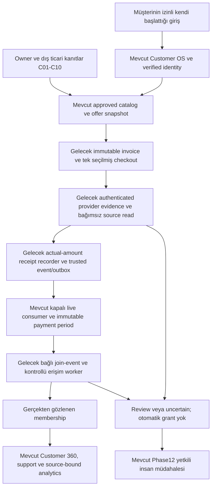

# Phase 16B — Ticari kapsam ve pilot mimari tasarımı

Tarih: 2026-10-18 UTC. Kanıt tabanı: `fec93a914b8dd29e39bcd431610b1ab3c11da46a`. Durum: **DESIGN ONLY — OWNER DECISIONS PENDING**. Bu dosya uygulama, provider aktivasyonu, üretim kurulumu veya pilot yetkisi değildir.

## 1. Yetki, kaynak önceliği ve mevcut durum

Owner yalnız Phase 16B araştırma, kapsam, tasarım ve iki belgenin korunan PR yoluyla yayımlanmasını yetkilendirdi. Phase 1–15 kabul sınırlarında CLOSED; Phase 16A COMPLETE — VERIFIED. Phase 16B yazılım uygulaması, 16C–16F, gerçek para/mesaj/VIP işlemi ve ticari pilot yetkisizdir. Bu yeni talimat, AGENTS/README/master/backlog içindeki önceki genel Phase 16 yasağını yalnız bu tasarım kapsamında aşar.

Başlangıç remote main ve GitHub API kontrolü: `fec93a914b8dd29e39bcd431610b1ab3c11da46a`, protected=true. Aktif [ruleset 25348710](https://github.com/AlisanMedia/GOLD-REVENUE-OS-PRO/rules/25348710), Application ve Database'i ayrı GitHub Actions `15368` kontrolleri olarak strict zorunlu tutuyor; PR gerekli, review count=0, bypass listesi boş. [Phase 16A PR #102](https://github.com/AlisanMedia/GOLD-REVENUE-OS-PRO/pull/102), [PR CI 39143739934](https://github.com/AlisanMedia/GOLD-REVENUE-OS-PRO/actions/runs/39143739934) ve [main CI 39144072922](https://github.com/AlisanMedia/GOLD-REVENUE-OS-PRO/actions/runs/39144072922) kabul kanıtıdır. Backlog B01'in eski protected=false satırı tarihsel gözlemdir; mevcut governance açığı değildir.

[Master context](../MASTER_PRODUCT_CONTEXT.md), [backlog](../NEXT_EXECUTION_BACKLOG.md), [Phase 15](../../PHASE_15_REPORT.md), [Phase 16A](../../PHASE_16A_GOVERNANCE_REPORT.md) ve [PILOT-ENTRY-v0.1](PILOT_ENTRY_v0.1.md) birlikte kullanılır. Tarihsel artifact/test başarısı yalnız kabul kapsamını ispatlar. Hosted DB bu tasarımda sorgulanmadı; eski invoice/subscription/model sayıları yeni runtime ölçümü olarak tekrarlanmıyor. Phase 14'ün yedi ürün kararı değişmedi ve tekrar onaya sunulmuyor.

## 2. Mevcut yatırım ve doğrulanmış sınırlar

| Kanıt | Kodda mevcut olan | Henüz sağlanmayan veya kısıtlı olan |
| --- | --- | --- |
| [K01: ticari sözleşme](https://github.com/AlisanMedia/GOLD-REVENUE-OS-PRO/blob/fec93a914b8dd29e39bcd431610b1ab3c11da46a/packages/domain/src/commercial.ts#L14) | Ürün/plan, süre, fiyat, eligibility, terms ve yayınlanmış versiyonlar | `service_rights` metni imzalı dağıtım lisansı değildir; ticari ürün/merchant onayı kanıtı yok |
| [K02: ödeme domain](https://github.com/AlisanMedia/GOLD-REVENUE-OS-PRO/blob/fec93a914b8dd29e39bcd431610b1ab3c11da46a/packages/domain/src/payments.ts#L11), [test route](https://github.com/AlisanMedia/GOLD-REVENUE-OS-PRO/blob/fec93a914b8dd29e39bcd431610b1ab3c11da46a/apps/web/src/app/api/webhooks/payments/%5Bprovider%5D/route.ts#L9) | Exact atomic units, yüzey kuralı, test invoice/evidence, replay ve reconciliation | Şema `mode=test`; route yalnız iki test provider kabul ediyor. Canlı checkout/factory yok |
| [K03: Stars evidence](https://github.com/AlisanMedia/GOLD-REVENUE-OS-PRO/blob/fec93a914b8dd29e39bcd431610b1ab3c11da46a/apps/web/src/lib/payments/telegram-evidence.ts#L4) | Secret-header, payer/payload/XTR amount doğrulama sözleşmesi | Route'a bağlı değil; recurring evidence reddediliyor; ledger mutabakatı ve canlı recorder yok |
| [K04: receipt/period](https://github.com/AlisanMedia/GOLD-REVENUE-OS-PRO/blob/fec93a914b8dd29e39bcd431610b1ab3c11da46a/supabase/migrations/20261013222720_phase11_subscription_access.sql#L3) | Private immutable receipt kimliği, trusted event, tek tüketilen payment period | Receipt authoritative received amount/currency içermez. Runtime receipt yazma/enable yetkisi yok |
| [K05: abonelik](https://github.com/AlisanMedia/GOLD-REVENUE-OS-PRO/blob/fec93a914b8dd29e39bcd431610b1ab3c11da46a/packages/domain/src/subscriptions.ts#L4) | UTC calendar-month/year clamping, fixed days, immutable dönem ve revision | Ürünün gerçek süre/grace/refund/repurchase politikası owner seçimi. Cancelled aynı plan versiyonuna ödeme [reddedilir](https://github.com/AlisanMedia/GOLD-REVENUE-OS-PRO/blob/fec93a914b8dd29e39bcd431610b1ab3c11da46a/supabase/migrations/20261013222720_phase11_subscription_access.sql#L100) |
| [K06: access worker](https://github.com/AlisanMedia/GOLD-REVENUE-OS-PRO/blob/fec93a914b8dd29e39bcd431610b1ab3c11da46a/apps/web/src/lib/entitlements/service.ts#L5), [adapter](https://github.com/AlisanMedia/GOLD-REVENUE-OS-PRO/blob/fec93a914b8dd29e39bcd431610b1ab3c11da46a/apps/web/src/lib/entitlements/adapter.ts#L17) | Test worker, dormant server-allowlisted gerçek adapter; fenced job/lease | Deployed worker LIVE reddeder. Ayrı eski Telegram verifier, entegre merchant→VIP canlı döngüsü değildir |
| [K07: inbound](https://github.com/AlisanMedia/GOLD-REVENUE-OS-PRO/blob/fec93a914b8dd29e39bcd431610b1ab3c11da46a/apps/web/src/app/api/webhooks/telegram/route.ts#L61), [cron](https://github.com/AlisanMedia/GOLD-REVENUE-OS-PRO/blob/fec93a914b8dd29e39bcd431610b1ab3c11da46a/apps/web/src/app/api/cron/entitlements/route.ts#L9) | Private text ingestion; test entitlement cron route | Join/payment update routing ve canlı event loop bağlı değil; [vercel.json](../../vercel.json) yalnız agent cron içeriyor |
| [K08: claim fence](https://github.com/AlisanMedia/GOLD-REVENUE-OS-PRO/blob/fec93a914b8dd29e39bcd431610b1ab3c11da46a/supabase/migrations/20261013222720_phase11_subscription_access.sql#L165) | Leases, retry, revision/stale guards | live_enabled kapalıysa revoke dahil job claim durur; ayrı güvenli incident repair yolu kabul edilmeden canlı açılamaz |
| [K09: admin projection](https://github.com/AlisanMedia/GOLD-REVENUE-OS-PRO/blob/fec93a914b8dd29e39bcd431610b1ab3c11da46a/supabase/migrations/20261013222720_phase11_subscription_access.sql#L205) | Tenant/RBAC kontrollü subscription görünümü | Subscription dışındaki access/payments/jobs/audit aggregate'ları sınırsız. Performans olayı veya exploit kanıtlanmış değil |
| [K10: analytics](https://github.com/AlisanMedia/GOLD-REVENUE-OS-PRO/blob/fec93a914b8dd29e39bcd431610b1ab3c11da46a/packages/domain/src/analytics.ts#L22) | 41 typed metric, LIVE/SANDBOX ayrımı, unknown=null, anon k≥5 | Gerçek tutar, refund, billing/cost ve accounting policy eksikse finansal sonuç UNAVAILABLE |

Mevcut Next.js + TypeScript + Supabase/Postgres modular monolith, transactional outbox ve onaylı role/audit sınırları korunur. İkinci CRM, ledger, queue servisi, warehouse veya mikroservis tasarlanmaz. Lead qualification, hukuken gerekli suitability/appropriateness değerlendirmesinin yapıldığına kanıt değildir.

## 3. Üç iş modeli — owner kararı yerine geçmeyen karşılaştırma

| Boyut | A — Lisanslı sinyal yeniden satışı | B — B2B Revenue OS | C — Hibrit |
| --- | --- | --- | --- |
| Satılan şey / gelir | Yetkili içerik/hizmet üyeliği; genuine tahsilat ve yenileme | Yazılım kullanım ve varsa kurulum/operasyon hizmeti bedeli; ayrı B2B sözleşme/fatura | A üyeliği ve B yazılım/hizmet sözleşmesi ayrı ekonomik kapsamlar |
| Gerekli talep kanıtı | Yasal erişime sahip müşterinin gerçek satın alma niyeti; henüz yok | Yetkili işletmenin problem, bütçe ve satın alma onayı; henüz yok | Her iki tarafta da ayrı talep ve teslim kanıtı |
| Supplier/hak bağımlılığı | İmzalı redistribution/sublicensing, marka, ülke, süre, kanal, tercüme ve sona erme hakları | Kendi SaaS IP/hizmet sözleşmesi; müşteri kendi ürün/hak/merchant sorumluluğunu kanıtlar. İçerik yeniden dağıtımı önerilmez | İki hak zinciri, çıkar çatışması ve veri/merchant ayrımı |
| Regülasyon / coğrafya | Hizmetin kişiselleştirilmesi, araçlar, pazarlama ve ülke bazında yüksek doğrulama ihtiyacı | Salt operasyon yazılımı önerisi; finansal tavsiye/satış aracılığına dönüşürse ayrı inceleme. Hukuk muafiyeti yok | Her iki modelin yükümlülüğü; yazılım etiketi içeriğin niteliğini değiştirmez |
| Brüt katkı sürücüleri | Gerçek tahsilat/refund/vergi eksi lisans/minimum garanti, fee, support, AI, altyapı | Gerçek software/service bedeli eksi onboarding/support/AI/altyapı/fee; müşterinin GMV'si platform geliri değil | Ayrı kaynaklı gelir/maliyet kapsamları; iç transfer veya GMV iki kez sayılmaz |
| Acquisition / retention | Marka müşteri ilişkisini yönetebilir; içerik kalitesi ve supplier sürekliliğine bağımlı | B2B satış ve operasyon değerinin kanıtı; tenant müşterilerinin dönüşümü ayrı ölçülür | Çapraz satış hipotezi; doğrulanmış gelir veya retention artışı yok |
| Veri / taşınabilirlik | Consent/retention ve supplier veri haklarıyla sınırlı | Controller/processor, DPA, sona erme/export/delete sınırı sözleşmede belirlenir; kişisel veri sınırsız mülkiyet değildir | Amaç/tenant ayrımı olmadan müşteri verisi paylaşılamaz |
| Tekrarlanabilirlik / karmaşıklık | Her provider/ülke/ürün için hak ve kalite incelemesi | Aynı güvenli operasyon akışının yetkili abonelik işletmelerinde tekrar kullanımı; self-serve SaaS billing henüz yok | Daha fazla ürün, hukuk, muhasebe ve operasyon varyantı |
| Dış trading provider bağımlılığı | Yüksek; supplier kaybı teslimat ve yenilemeyi etkiler | Operasyon ürünü doğrudan sinyal tedarikine bağlı olmayabilir; müşterinin iş riski sürer | İçerik kolunda yüksek; yazılım kolunda ayrıca ayrıştırılmalı |
| Uzun vadeli savunulabilirlik | Lisans münhasırlığı/kalite/marka; mevcut olduğu varsayılmaz | Güvenilir receipt/operasyon kanıtı, entegrasyon taşınabilirliği, düşük operasyon maliyeti; ölçülmesi gereken hipotez | İki kolun avantajı ancak haklar ve ekonomi kanıtlanırsa; erken aşamada odak maliyeti |

**Öneri, onay değil:** İlk ticari doğrulama B; bir yetkili işletmeye sınırlı yazılım/operasyon hizmeti. Mevcut yatırımın en büyük kısmını kullanır, içerik satın alma ve yeniden dağıtma ihtiyacını başlangıç kapsamından çıkarır. Talep, fiyat, kâr ve müşteri yetkisi henüz kanıtlanmış değildir. B2B fee için yeni self-serve billing/komisyon sistemi yapılması önerilmez. A veya C ancak ayrı hak/merchant/legal kanıtla yeniden seçilebilir; bu belgeler seçimi owner adına yapmaz.

B modelindeki işletmeye yazılım satışı ile o işletmenin üyelik müşterisine satışı farklı satıcı/para akışıdır. Pilot için bir adet üye ürünü ve bir ödeme yüzeyi seçilir; software fee'nin ayrı ticari sözleşmesi bu checkout'a karıştırılmaz. “10 müşteri”nin **bir tenant'ın 10 son üyesi** olarak sayılması öneridir; 10 B2B işletme anlamı owner tarafından seçilirse single-tenant pilot tasarımı ayrıca revize edilmelidir. İki paydayı birleştiren conversion/revenue metriği yoktur.

## 4. Birincil kaynaklar ve ticari/hukuki sınırlar

Kaynaklar 2026-10-18 tarihinde okundu. Aşağıdaki kısa bulgular teknoloji/politika incelemesidir; seçilmiş ürün/şirket/ülke için avukat, mali müşavir veya merchant onayı değildir. Tam mevzuat değişiklik zinciri ya da her ülke için lisans araştırması yapılmış sayılmaz.

| Kaynak | Doğrulanan sınır / tasarıma etkisi |
| --- | --- |
| [S01 Telegram digital goods / Stars](https://core.telegram.org/bots/payments-stars) | Telegram uygulaması içindeki bot/Mini App dijital satışları XTR kullanır; dış web sitesinin varlığı bunu kaldırmaz. Pre-checkout ödeme başarısı değildir. /paysupport, anlaşılır terms ve dispute/refund işletimi gerekir |
| [S02 Telegram developer terms](https://telegram.org/tos/bot-developers) | Merchant geliştirici yükümlülükleri ve erişilebilir privacy policy gerekir. Fragment reward erişimi ülkeye/kullanıcıya göre engellenebilir; Stars edinim fiyatı, bot bakiyesi, reward ve banka nakdi eşit değildir |
| [S03 Bot API: ledger/refund/recurrence](https://core.telegram.org/bots/api#getstartransactions) | Callback'ten ayrı ledger okuması mümkün; charge ID eşleşmesi yapılabilir. Refund aynı original transaction ID'yi kullanabilir. Native recurring süre şu an 2.592.000 saniye/30 gün; takvim ayı sayılmaz |
| [S04 SPK izinsiz faaliyetler](https://spk.gov.tr/yatirimcilar/izinsiz-sermaye-piyasasi-faaliyetleri) | Yatırım danışmanlığı dahil düzenli yatırım hizmet/faaliyetleri izin kapsamındadır. Bir supplier lisansı veya disclaimer kendiliğinden SPK yetkisi vermez |
| [S05 SPK rehber i-SPK.37.9](https://spk.gov.tr/data/61e496a11b41c60d1404d6b2/Yat%C4%B1r%C4%B1m%20Hizmet%20ve%20Faaliyetleri%20ile%20Yat%C4%B1r%C4%B1m%20Kurulu%C5%9Flar%C4%B1na%20%C4%B0li%C5%9Fkin%20Rehber%20%28Versiyon%2C%20i-SPK.37.9%29.pdf) | Rehberin 17.06.2026 güncellemesi, D/E bölümlerinde yatırım danışmanlığı, genel yatırım tavsiyesi ve finansal bilgiyi ayırır. Bütün sinyaller otomatik olarak aynı hukuki sınıf değildir; bire bir kişiselleştirme/dağıtım biçimi somut incelenmeli |
| [S06 TCMB yönetmelik, m.3–4](https://www.tcmb.gov.tr/wps/wcm/connect/6937855a-7c29-4d08-a26e-51ef3273c022/%C3%96demelerde+Kripto+Varl%C4%B1klar%C4%B1n+Kullan%C4%B1lmamas%C4%B1na+Dair+Y%C3%B6netmelik.pdf?MOD=AJPERES), [resmî duyuru](https://www.tcmb.gov.tr/wps/wcm/connect/TR/TCMB+TR/Main+Menu/Duyurular/Basin/2021/DUY2021-17) | Kripto varlıkların ödemelerde doğrudan/dolaylı kullanımı ve buna yönelik hizmetler kısıtlıdır. Türkiye'ye tabi pilot için external crypto “teknik olarak mevcut” diye seçilemez. Stars/Fragment yerel sınıflandırması ayrıca incelenir; Stars'a otomatik kripto veya yasal fiat checkout denmez |
| [S07 KVKK yurt dışı aktarım](https://www.kvkk.gov.tr/Icerik/2053/Yurtdisina-Aktarim) | Güncel m.9 çerçevesi, yeterlilik/uygun güvence/istisnaları ayırır; standart sözleşme ve bildirim gibi yöntemler koşulludur. Cloud/AI/Telegram veri akışı ve taraf rolleri haritalanmalı; genel bir rıza her aktarımı çözmez |
| [S08 KVKK 2026/347](https://www.kvkk.gov.tr/Icerik/8710/veri-sorumlulari-tarafindan-acik-riza-ve-aydinlatma-metinlerinin-ayri-ayri-duzenlenmesi-gerektigi-hakkinda-kisisel-verileri-koruma-kurulunun-18-02-2026-tarihli-ve-2026-347-sayili-ilke-kararina-iliskin-kamuoyu-duyurusu) | Aydınlatma ve açık rıza birbirine karıştırılmaz. İşlem farklı bir hukuki sebebe dayanıyorsa sırf checkbox eklenerek açık rıza icat edilmez |
| [S09 Ticaret Bakanlığı ticari ileti](https://www.ticaret.gov.tr/ic-ticaret/ticari-elektronik-iletiler/genel-bilgiler), [İYS](https://ticaret.gov.tr/ic-ticaret/ticari-elektronik-iletiler/ileti-yonetim-sistemi-iys) | Ticari ileti onayı/red hakkı ve tacir/esnaf istisnası ayrı kurallardır. Telegram'a uygulanacak kapsam uzman incelemesidir; B2B istisnası mevcut contactability/opt-out güvenliğini gevşetmez |
| [S10 Mesafeli sözleşmeler](https://tuketici.ticaret.gov.tr/yayinlar/tuketici-bilgi-rehberi/mesafeli-sozlesmeler-hakkinda-bilgilendirme) | Ön bilgilendirme, cayma/istisna ve iade ayrımı gerekir. Anında dijital ifa istisnası tüm devam eden VIP hizmetlerini otomatik “iadesiz” yapmaz; finansal hizmet sınıflandırması ayrıca incelenir |
| [S11 GİB eBelge resmî portalı](https://ebelge.gib.gov.tr/anasayfa.html) | Vergi/eBelge incelemesinin resmî başlangıç kaynağıdır; bu portal seçilmiş işlem için vergi oranı veya ihracat istisnası kanıtı değildir. Satıcı, mukimlik, müşteri statüsü, hizmet yeri, fatura/KDV ve payout muhasebesi mali müşavire gider |

[ADR-006](../adr/ADR_006_PHASE10_MULTI_CHANNEL_PAYMENTS.md) Telegram kaynaklı dijital satışı dış crypto checkout'a yönlendirmeyi zaten yasaklar. Bağımsız web seçeneği yalnız müşterinin Telegram dışındaki gerçek girişinden başlayan, kanıtı saklanan ayrı ve ayrıca yetkili bir akıştır; referrer veya browser `surface=web` değeri tek başına köken/yetki kanıtı değildir. Bu teknik tasarım ne ülke yasağını ne platform kuralını aşma yoludur.

Türkiye olası inceleme pazarıdır, seçilmiş pazar değildir. Türkçe admin dili/owner konumu müşteri ülkesi veya merchant mukimliği kanıtı olmaz. AB/AEA, UK, ABD ve başka pazarlar seçilmedi; oralarda finansal tanıtım, lisans, tüketici, yaptırım, privacy ve vergi gereklilikleri ayrıca değerlendirilmeden “global compliant” etiketi yoktur. Approved supplier sözleşmesi; hak sahibi/temsil yetkisi, sublicense/redistribution, paid group/web, ülke, marka, tercüme/değişiklik, veri kullanımı, süre, fesih ve ücret/teslim sürekliliğini açıkça kapsamalıdır. Sağlayıcıya abone olmak yeniden satış izni değildir; her sinyal/fact'in telif niteliği de varsayılmaz.

## 5. C01–C10 karar ve kanıt sicili

**K = doğrulanmış mevcut karar/kontrol; P = öneri; A = owner kararı bekleniyor; E = dış kanıt bekleniyor.** “Blocking” aşağıda canlı pilota ilişkindir; eksik canlı kararlar bu tasarım tesliminin yapılmasını engellemez.

| ID | K / P | Eksik owner kararı ve dış bağımlılık | Teknik bağımlılık / kabul kanıtı | Sorumlu / durum |
| --- | --- | --- | --- | --- |
| C01 Ürün, model, hak | K: versioned catalog; P: önce Model B | A: A/B/C, tek tenant/marka/ürün ve pilot paydası. E: tedarikçi hak zinciri veya B2B müşteri yetki/sözleşmesi, gerçek talep | Onaylı ürün/plan/version ve rights-review referansı; izin süresi/ülke/kanal uyumu; `service_rights` tek başına yetmez | Owner + commercial/legal; **A/E, blocking** |
| C02 Kanal, merchant | K: ADR-006 Stars/independent-web sınırı | A: tek checkout yüzeyi, seller-of-record, merchant tüzel kişiliği/ülke. E: provider kabulü ve payout/geo koşulları | Server-owned merchant→tenant mapping; şartlarla uyumlu source provenance; alternatif rail kendiliğinden açılmaz | Owner + merchant/legal; **A/E, blocking** |
| C03 Finansal doğruluk | K: test sınırı, bağımsız verification sözleşmesi; P: aşağıdaki receipt envelope | A: gerçek provider test penceresi ayrıca. E: authenticated gerçek received/refund ve merchant kaynakları | Tutar/currency/asset/network/payer/charge + source hash/time; callback ve bağımsız okuma; bir receipt→bir immutable period. Canlı writer yok | Engineering + merchant/accounting; **teknik eksik + E, blocking** |
| C04 Süre/erişim | K: calendar/fixed-day ve fenced dönemler; P: otomatik tahsilatsız ilk kapsam | A: gerçek süre, grace, renewal, cancel/refund/repurchase etkisi. E: private channel/permission onayı | Numeric user/channel binding; join, expiry/revoke/reconcile, late side-effect repair; native recurring/calendar farkı çözülmeli | Owner + ops/engineering; **A/teknik, blocking** |
| C05 Terms, claims, vergi | K: approved commercial facts sınırı | A: sözleşme/disclosures, support, price/tax/discount/refund/cancel kuralları. E: avukat/mali müşavir ve varsa performans kanıtı | Satış öncesi terms version/acceptance; gerçek vergi/fatura politikası; onaysız getiri/garanti iddiası yok | Owner + legal/tax; **A/E, blocking** |
| C06 Consent/privacy | K: tenant/RLS, opt-out, Phase14 kimlik ayrımı ve k≥5; mevcut survey kararları final | A: exact cohort, amaç/kapsam, retention/deletion/legal hold, jurisdiction. E: lawful processing/contact ve cloud aktarım/DPA kanıtı | Service/survey/marketing amaçları ayrılır; bilinmeyen izin fails closed; import kilitli; anonim cevap named profile'a bağlanmaz | Owner + privacy/ops; **A/E, blocking** |
| C07 İnsan operasyonu | K: Phase12 case/takeover ve önceki tek sandbox manager alert kanıtı | A: primary/backup roller, saat/ack/response hedefleri, gerçek uyarı gönderim yetkisi | Eğitimli operatör; case/receipt ve notification drafted/queued/sent/uncertain ayrımı; dönem/kapsam onaylı rota | Owner + ops; **A, blocking** |
| C08 Üretim/recovery | K: 16A main ve staging/Production GitHub environment korumaları | A: gerçek production kurulumu, MFA/secret sahipliği ve recovery hedefi ayrıca. E: plan, backup/restore kabiliyeti | Ayrı app/DB/bot/merchant kaynakları; backup/restore+event replay+external reconcile drill; mevcut runbook tek başına proof değil | Owner + infra/security; **A/E/teknik, blocking** |
| C09 Ekonomi/kapasite | K: kaynaklı telemetry ve eksik cost=unknown; P: ölçüme göre sınırlar | A: günlük/aylık/üye bütçe, queue/p95/expiry lag, gözlem penceresi. E: gerçek supplier/AI/hosting/fee/staff fiyat ve kota belgeleri | Tenant kaynaklı billing coverage, queue age, burst ve bounded queries; tüm kritik cost yoksa margin/CAC/LTV/ROI UNAVAILABLE | Owner + finance/engineering; **A/E, blocking** |
| C10 Release/cohort | K: iki zorunlu CI, PR, bypass yok; P: her aşamada ayrı go | A: exact uygulama SHA'sı ve hedef/tutar/mesaj sayılı provider kabulü; sonra 10/25/50/100 için ayrı izin | Exact-head ve main iki CI; seçilmiş entegre yolun yeni kabulü; sıfır açık P0/unauthorized action ve tam mutabakat | Owner release authority; **NO-GO; bu belge rollout yetkisi değil** |

## 6. En küçük tek-tenant pilot mimarisi — gelecek tasarımı

Tek konfigürasyon paketi önerilir: `commercial_model`, `seller_of_record`, `merchant_account`, `tenant`, `brand`, `rights_reference`, `product_version`, `plan_version`, `checkout_surface`, `billing_terms`, `eligible_cohort`, `delivery_channel`. Bunlar önerilen sözleşme alanlarıdır; migration/DB enum'u değildir. Henüz seçilmeyen alanlar NULL/PENDING kalır ve canlı başlatma koşulunu karşılamaz. İlk kapsamda bir ürün/plan, bir tenant/marka ve tek ödeme yüzeyi; alternatif provider, multi-channel bundle, upgrade/proration ve otomatik recurring collection yoktur. Bu da owner onayı bekleyen daraltma önerisidir.

Kesik olmayan oklar bu şemada **tasarlanan iş akışını** gösterir; deployment gerçeği bölüm 2'dedir. Invoice/live recorder/join router/production worker bağlı değildir. Test akışı bu çizgiye dönüştürülmez. AI yalnız onaylı bilgiyle iletişim önerir; receipt, ödeme, abonelik veya access otoritesi kazanmaz. Tenant izolasyonu mevcut sınırdır; B2B self-serve provisioning, platform subscription billing ve tenant switch bu tasarımda yapılmaz.

## 7. Gelecek payment-to-VIP sözleşmesi

| Adım | Girdi / deterministik koşul | Çıktı / güvenli başarısızlık |
| --- | --- | --- |
| 1 Approved offer | Tenant/customer; current approved product/plan/terms/rights; geçerli fiyat ve audience | Immutable offer/version snapshot. Eligibility veya rights bilinmiyorsa checkout yok |
| 2 Intent/invoice | Server-owned tek merchant/surface; expected payer; exact amount/asset/network/precision; expiry; quote kaynağı | Tek invoice idempotency anahtarı. Mevcut test invoice LIVE'a UPDATE edilmez; gerçek checkout yeni ayrı yetki ister |
| 3 Provider evidence | Authenticated raw update/callback, bounded bytes, kaynak event/order/charge ve observed/provider times | Immutable observation + hash. Telegram secret-header/TLS authentication, asimetrik dijital imza diye sunulmaz; client success/screenshot/pre-checkout yetersiz |
| 4 Independent verification | Invoice/merchant/tenant/payer/received amount/currency ve seçilmiş rail kanıtı | Callback iddiasından bağımsız server read. Kısmi/erişilemeyen kaynak PENDING/REVIEW; AI/operator “paid” yapamaz |
| 5 Financial receipt | Doğrulanmış kaynaklar, invoice binding, tutar ve karar sürümü; özgün payment kimliği | Dar yetkili recorder ile receipt + trusted event + outbox aynı DB transaction. Kaynak booleans'ı browser/AI gönderemez. Runtime için genel receipt INSERT açılmaz |
| 6 Subscription period | Aynı tenant/customer/offer; tek receipt veya test için ayrı test event; mevcut state ve revision | Mevcut consumer bir receipt'i bir kez uygular; immutable period/snapshot/audit ve erişim işi atomic. Event ack kaybı replay ile ikinci dönem yaratmaz |
| 7 Identity/channel | Verified numeric Telegram user, onaylı private channel ve aynı tenant/mode | Username veya serbest client chat ID yetki sağlamaz. Server allowlist/bot izinleri kontrol edilir |
| 8 Join/delivery | Current valid entitlement, current revision/lease, o kullanıcı/link/channel için gerçek join request | Süreli approval-required link; matching request approval ve membership read-back. Invite veya approval tek başına “VIP active” değildir |
| 9 Renewal/end/refund | Gerçek yeni payment, immutable terms, effective cancellation ve verified refund evidence | Kalender/fixed-day korunur; refund bir önceki geliri silmez. Owner policy yoksa otomatik proration/repurchase/charge yok |
| 10 Recovery | Duplicate/concurrent/out-of-order, crash, 429, timeout, hold/permission change | Aynı recorder/idempotent consumer; bounded retry, lease/revision, uncertain+reconcile ve auditli correction. DB rollback dış provider etkisini geri alamaz |
| 11 Operator/BI | Yetkili source projection; ödeme, dönem, üyelik ve delivery ayrı durumlar | Customer 360/Admin evidence; Phase15 unknown/null ve ayrı varlık/ağ grupları. Test bakiye/offer/subscription gerçek nakit sayılmaz |

### 7.1 Rail'e özgü doğrulama

**Stars adayı:** `[merchant bot, charge_id]` kimliği, invoice payload, expected numeric payer ve XTR tutarı authenticated successful_payment ile bağlanır. Callback dışında `getStarTransactions` sonucunda aynı incoming invoice payment, user/payload ve tutar eşleşmesi aranır. Bounded sayfalama, dedup ve kapsam tamamlığı kanıtı gerekir; eksik sayfa veya kaynak kesintisi başarı sayılmaz. Bu, callback'ten bağımsız okuma olup bağımsız üçüncü taraf finansal denetim değildir. Belge/S01–S03 okundu; gerçek Bot API çağrısı yapılmadı.

Stars chargeback/refund riski bitti diye varsayılmaz. Refund satırı original transaction ID'yi kullanabileceği için sadece charge ID ile bütün event'leri düşüren dedup tasarlanmaz; payment/refund yönü/türü ve provider source identity ayrılır. Ambiguous kimlik REVIEW kalır. Native recurring mevcut verifier tarafından reddediliyor; ayrıca onaylanmış yeni tasarım olmadan açılmaz. Otuz gün, calendar_month'a sessiz çevrilmez. İlk one-off önerisi dahi owner'ın plan/süre onayını bekler.

**Bağımsız web crypto yalnız koşullu aday:** Merchant ülke/ürün kabulü ve hukuki izin yoksa seçilemez. Approved asset contract/network/recipient/precision ve kaynağı belli finality kuralı; authenticated webhook dışında invoice ve canonical transfer/confirmations okuması gerekir. Tek hash içindeki transfer index'leri ayrılır. Wallet adresi kişinin hukuki kimliğini ispatlamaz; payer/order bağlantısı provider'ın desteklediği kanıtla çözülür. Reorg/underpayment/overpayment/wrong network REVIEW veya pending kalır. Hiçbir crypto provider/coin/ağ seçilmedi; Telegram'dan bu checkout'a yönlendirme yoktur.

### 7.2 Actual-amount receipt envelope — uygulanmamış gereksinim

Mevcut receipt kimliği ve trusted event'ler yeniden kullanılır. Sonraki ayrı onayda, gerçek kaynağı olmayan miktarları doldurmadan, aşağıdaki semantik kapsam çözülmelidir: provider+merchant source identity; invoice/offer/customer/tenant binding; received atomic amount ve decimals; currency/asset/network/contract; payer/recipient; charge/transfer index; authenticated source hash/time; independent-read reference/time; verification/finality policy version; original payment/refund bağlantısı; correction/reconciliation nedeni. Bu alan listesi yeni SQL şeması veya yazma yetkisi değildir.

Fiat plan fiyatı ile alınan XTR/asset ayrı kayıttır. Quote kaynağı/validity owner-approved olmalı; FX ve vergi/recognition policy yoksa tek para birimi revenue toplamı icat edilmez. XTR receipt, banka hesabına tahsil edilmiş TRY/USD değildir. Supplier payout ve B2B software fee müşterinin üyelik tahsilatına eklenerek iki kez sayılmaz. MRR için gerçek period amount + approved recurring basis gerekir; fixed-day monthly normalizasyonu hâlâ ayrı policy. Eksik maliyetle margin/CAC/LTV/ROI açılmaz.

Financial fact ile fulfillment eligibility farklıdır: expired invoice'a gerçekten gelen para silinmez veya saklanmaz; kaynak gözlemi tutulur, yanlış müşteri/late funds entitlement'a otomatik bağlanmaz. Uygun invoice/receipt bağlantısı ve gerekirse gerçek refund, yalnız doğrulanmış kaynak ve ayrı yetkiyle çözülür. Manager review finansal gerçek yaratamaz.

## 8. Sonraki uygulama için negatif ve pozitif kabul matrisi

**Aşağıdakiler tasarım kabul kriteridir; bu 16B'de çalıştırılmış/yeni PASS testler değildir.** Önce provider transport'u fake ve açık synthetic fixture'larla CI'da yapılabilir. Gerçek provider acceptance yalnız yeni exact hedef/tutar/count izniyle mümkündür.

| ID | Senaryo | Beklenen kanıt / sonuç |
| --- | --- | --- |
| T01 | Geçerli synthetic purchase, doğru sources | Mevcut active/outbound-disabled phase11-sandbox kurallarına uygun fixture'da bir test receipt eşdeğeri/bir dönem/bir source chain; production LIVE yetki veya provider call yok |
| T02 | Aynı callback ve concurrent reconcile | Tek canonical payment, tek immutable period; idempotent audit/ack; ikinci grant yok |
| T03 | Aynı event ID, farklı payload/hash | Conflict/review; önceki evidence overwrite edilmez |
| T04 | Yanlış tenant/customer/merchant/provider | HTTP/RPC ve kaynak binding reddi; başka tenant'ta state değişmez |
| T05 | Yanlış payer veya username-only binding | Otomatik period/join yok; üçüncü kişiye ait para varsayımla customer'a atanmaz |
| T06 | Eksik/fazla tutar, yanlış currency/asset/contract/network/recipient | REVIEW; float round-off, ticker benzerliği veya sonradan değişen quote ile kabul yok |
| T07 | Expired invoice / late actual funds / revoked offer | Gerçek kaynak gözlemi korunur; otomatik fulfillment yok; gerekçeli review/correction |
| T08 | Screenshot, client success, yalnız pre-checkout | Doğrulanmış receipt/PAID/subscription/access üretmez |
| T09 | Yanlış secret/signature, oversize, unsupported source | DB lookup/financial effect öncesi red; sensitive body log'a girmez |
| T10 | Ledger eksik/erişilemez, duplicate/offset drift | Tam source match olmadan independent_verified yok; bounded recovery, uncertain/pending görünür |
| T11 | Refund original charge ID tekrar kullanıyor | İlk payment silinmez; refund ayrı source türü/yönüyle idempotent; iki iade sayılmaz |
| T12 | Insufficient finality/reorg (yalnız izinli crypto adayı) | Finality policy sağlanmadan fulfillment yok; sonraki reorg için yeni auditli review/repair |
| T13 | Commit sonrası ack kaybı / worker crash | Receipt/event/outbox tekrarından ikinci dönem oluşmaz; yarım iş deterministik tamamlanır |
| T14 | Lease süresi dolması / stale revision / hold sırasında provider başarılı | Stale completion state'i diriltmez; gerçek dış etki reconcile edilip scoped repair'e gider |
| T15 | Yanlış user/channel/link, expired/revoked invite veya hiç join request yok | Approve yok; önceden polling approve loop'u yok; izinsiz membership yok |
| T16 | Bot permission loss / 429 / provider timeout | Başarı iddiası yok; bounded retry, uncertainty, manager case; gerçek manager-send bu testte yok |
| T17 | Calendar month/year, leap day, fixed days ve provider 30-day | Mevcut subscriptionExpiry ile exact UTC sonuç; provider recurrent period calendar month diye etiketlenmez |
| T18 | Cancellation request / effective cancel / expiration | Ayrı anlamlar; onaysız term-end veya immediate policy varsayılmaz; mevcut CANCELLED terminal kuralı korunur |
| T19 | Cancelled aynı versiyonda tekrar satın alma / yeni plan overlap | Mevcut red/hold görünür; owner policy ve ayrı değişiklik olmadan sahte çözüm yok |
| T20 | Refund, başka geçerli paid period mevcut | Source-referenced reversal; kalan hakkın sonucu approved policy ile hesaplanır; tüm customer erişimi körlemesine silinmez |
| T21 | TEST observation veya değişmiş mode/client flag | LIVE financial event, receipt, customer PAID veya gerçek access üretemez |
| T22 | Human takeover, opt-out, unknown contact scope, eski draft | Yeni marketing/AI reply yok; return-to-AI eski draft göndermez; review send yetkisi değildir |
| T23 | Bilinmeyen cost/denominator veya XTR/fiat karışımı | UNAVAILABLE/INCOMPLETE; 0 veya 100% margin/false collected cash yok |
| T24 | Anonymous response ve küçük grup | Named customer join/export yok; Phase14 k≥5 ve suppression korunur |
| T25 | Read API pagination, RBAC, drift, düşük mobil genişlik | Bounded ve stable pages; wrong tenant/role red; current customer/context görünür, teknik evidence ikincil |
| T26 | Kill switch ve gerçek dış üyelik tutarsızlığı | Yeni admission/grant durur; yetkili correction yolu ayrıca ispatlanır; mevcut switch'in her şeyi geri aldığı iddia edilmez |

## 9. Operatör ve müşteri deneyimi tasarımı

Mevcut panelde gelecekte izlenecek yol: **Müşteri → Teklif → Ödeme Kanıtı → Abonelik Dönemi → VIP Teslimi → Gerekirse İnceleme Merkezi**. Yeni ayrı CRM veya debug ağırlıklı ekran önerilmez. Primary görünümde anlaşılır status, next action, owner, bekleme süresi ve TEST/LIVE/uncertain ayrımı; source kimliği/ham teknik ayrıntı sadece yetkili ikincil bölümde. Payment review ile gerçek refund yetkisi ayrıdır. Manager alert'in draft/queued olması “yönetici bilgilendirildi” değildir.

Customer English varsayılandır; doğrulanmış EN/TR/AR/RU tercihleri korunur, admin tr-TR/en-US seçimi bunu değiştirmez. Örnekler yalnız gerçek backend koşuluyla kullanılabilir: verification pending → “Your payment is being verified. Please do not pay again while we check it.”; receipt doğrulandı, access hazır değil → “Your payment is verified. We’re preparing your membership access.”; observed membership yoksa “VIP active” denmez. Yeni gerçek mesaj bu tasarımda yoktur.

## 10. Pilot işletimi ve sayısal olmayan bilinmeyenler

| İşletim girdisi | İstenen kanıt | Bilinmeyen durum / stop |
| --- | --- | --- |
| Rights/merchant/claims | İmzalı yetki, ürün/ülke/kanal coverage; approved description/terms; varsa doğrulanabilir performans kanıtı | Supplier permission veya merchant kabulü yoksa satış yok; garanti veya fabricated başarı oranı yok |
| Consent/privacy | Amaç bazlı lawful processing/contact, exact cohort, opt-out, retention/legal hold, DPA/subprocessor/transfer haritası | Contact kaydı, /start veya eski görüşme broad marketing/survey consent değildir; imports LOCKED |
| İnsan kapasitesi | Primary/backup sorumluluğu, operating hours, ack/response ve incident escalation | İsimler/kişisel iletişimler private operasyon kaydında tutulur; eksik coverage no-go |
| Üretim izolasyonu | Ayrı runtime/DB/bot/merchant/secrets, MFA ve least privilege; reviewed exact commit | Yeni production bu scope'ta kurulmaz. Staging production-named target ticari prod değildir |
| Recovery | Kaynaklı backup planı, restore/replay drill, approved RPO/RTO, receipt/period/membership mutabakatı | Runbook varlığı test edilmiş restore değildir. Kalıcı database reset veya audit/receipt silme yok |
| Maliyet/kapasite | Güncel plan/fiyat/usage/fee/supplier/staff kanıtı; model request billing dedup; burst/queue/query ölçümü | Sıfır maliyet varsayılmaz; nominal kullanıcı sayısı kapasite kanıtı değildir |
| Limitler | Owner-approved günlük/aylık/üye spend; queue age, p95, expiry lag, hata ve observation window | Bütün eşikler **TBD**. Bu belgede rastgele SLA/RPO/RTO/bütçe üretilmez; eksik eşik pilotu açmaz |
| Release/incident | İki exact check + owner environment approval; named incident owner ve uyumlu rollback SHA | CI outage veya açık P0: release durur; governance bypass ile ilerlenmez |

Katkı hesabı ancak kaynaklar tamamlanınca, aynı currency ve approved tax/refund kapsamıyla yapılabilir: A için gerçek net membership receipts eksi supplier/fee/AI/support/infra; B için gerçek software/service bedelleri eksi o hizmetin doğrulanmış maliyetleri; C için iki kol ayrı ve çift sayım yok. Stars user acquisition price → reward veya fiat collected dönüşümü varsayılmaz. Vergi tahsilatı/gelir yazımı, FX ve accounting recognition uzman/owner kararıdır; Phase15 metric tanımları değiştirilmedi.

## 11. Incident, rollback ve 10 → 25 → 50 → 100 kapıları

Yeni satış/charge/grant admission ayrı durdurulabilmelidir. Durdurmak zaten verilmiş Telegram erişimini geri almaz. Mevcut live_enabled kontrolü revoke claim'ini de kapatır (K08); ayrı auditli, least-privilege düzeltme/reconciliation yolu tasarlanıp test edilmeden pilot yoktur. Belirsiz payment/send/access sonucu körlemesine tekrar edilmez. Onaylı terms'e göre insan çözümü ve gerçek source reconciliation gerekir; otomatik refund garantisi yoktur.

Rollback: son uyumlu app SHA'ya kontrollü dönüş; gerekirse reviewed forward DB correction; immutable receipt/period/audit korunur. Restore sonrası dış provider olayları replay edilip mevcut gerçek membership/funds ile mutabakat yapılır. [Mevcut rollback runbook](../../infra/runbooks/rollback.md) bu tasarımın başlangıcıdır, yeni restore kabulü değildir.

| Kapı | Measurable go kanıtı | No-go / rollback ve ayrı owner kararı |
| --- | --- | --- |
| 0 → 10 | C01–C10 tamam, pilot müşteri paydası açık; tek ürün/tenant/rail; exact release iki CI; yeni entegre financial→period→membership kabulü; kapsam içi kayıtların %100 mutabakatı; yetkisiz işlem=0, açık P0=0; cost/coverage/restore eşikleri tanımlı ve ölçülmüş | Herhangi bir eksik veya belirsiz işlemde 0. Production/provider/cohort için ayrı açık izin. Bu doküman go değildir |
| 10 → 25 | Owner'ın onaylı gözlem penceresi ve incident/SLA/spend verisi; ilk cohort destek ve mutabakatı temiz; due renewal/expiry yolu kanıtlı; 25 hedef burst/query ölçümü | Açık critical/uncertain veya sınır aşımı varsa 10'da kal; yeni admission durur. Owner'ın ayrı 25 go kararı |
| 25 → 50 | Bounded read/worker fairness; outage, permission-loss ve stale/crash recovery; 50 profiline göre plan/fee/staff/latency kapasitesi | Hedef veya coverage yoksa 25'te kal. Yeni provider/ülke/ürün scale iznine gizlenmez; ayrı 50 go |
| 50 → 100 | Olgun gerçek billing/renewal evidence; 100 hedef burst, restore/replay ve mutabakat; gerçek cost coverage ve açıklanmış ekonomi eksikleri | Başarısızsa 50'de kal. Eksik ekonomi profit=UNAVAILABLE; budget riski owner tarafından ayrıca kabul edilir; ayrı 100 go |

Sıfır yetkisiz işlem ve %100 mutabakat hedefleri önerilen güvenlik kabul şartlarıdır; gerçekleşmiş işletim istatistikleri değildir. Gözlem penceresi/latency/cost hedefleri belirlenmeden hiçbir kapı GO olmaz.

## 12. Risk sınıflandırması ve önerilen 16C–16F sırası

| Öncelik / tür | Bulgu | Kaynak / bağımlılık ve kabul |
| --- | --- | --- |
| P0 · ticari/hukuki bağımlılık | Model, hak, seller/merchant, ülke, terms ve izinli cohort kanıtı tamam değil | C01/C02/C05/C06; legal/merchant belgeleri ve owner kararı. “İş hukuka aykırı” hükmü değil, launch gate |
| P0 · doğrulanmış kasıtlı eksik | Gerçek tutarlı receipt writer ve entegre canlı payment/access loop yok | K02–K07; receipt provenance, source-bound atomic processing ve yeni dar kabul gerekir; mevcut test kapsamı regression değil |
| P0 · readiness bağımlılığı | Production recovery, operasyon coverage ve sayısal cap/SLAlar kanıtlanmadı | C07–C10; geçmiş staging veya CI bunu ispatlamaz |
| P1 · doğrulanmış tasarım sınırı | Join routing/scheduler bağlı değil; global live-off revoke'u da durduruyor | K07/K08; fake-provider event/lease/recovery testleri ve scoped correction; rollout ayrı |
| P1 · doğrulanmış read şekli | Admin access/payment/job/audit aggregate'ları sınırsız | K09/B08; bounded pagination/projection + auth/tenant/EXPLAIN ölçümü; outage/kapasite kaybı henüz ölçülmedi |
| P1 · doğrulanmış model sınırı | Cancelled aynı plan versiyonu ve yeni-version overlap kısıtları | K05, schema unique keys; owner repurchase/upgrade policy olmadan davranış değiştirilmez |
| P1 · tarihsel operasyon kanıtı | Eski izole verifier'da 58 premature join approval hatası | [ADR-007](../adr/ADR_007_PHASE11_FENCED_ENTITLEMENTS.md); event-driven/bounded recovery testi önerilir; üretim olayı veya yeni tekrar testi değildir |
| P1 · hipotez | Provider side effect lease/hold sonrası tamamlanabilir; analyst projection raw invitation içerebilir; plan overlap yanlış hak doğurabilir | Sentetik reproducer ve role projection incelemesi gerekir; doğrulanmış exploit olarak sınıflandırılmadı |
| P2 · bakım/opsiyonel | Action/runtime image drift, artifact retention; multi-brand, self-serve SaaS billing, partner economics ve FX | Ayrı ölçüm/talep/owner kapsamı; bu tasarımda upgrade, artifact taşıma, yeni servis veya white-label yok |

Aşağıdaki alt paket isimleri **önerilen çalışma sırasıdır**, onaylı yeni faz kapsamı değildir:

| Paket | En küçük amaç / değer | Bağımlılık / kabul | Karmaşıklık / yetki |
| --- | --- | --- | --- |
| 16C-0 — önce uygulanabilir öneri | B08 için bounded entitlement Admin read-model ve güvenli ikincil evidence sayfaları; operasyon maliyeti/yanıt boyutu kontrolü | Ticari supplier/provider seçimi beklemeden synthetic CI. Existing list consumers reuse; page sınırı, stable pagination, role/tenant red, evidence kaybı olmaması; önce projection/EXPLAIN baseline. Finansal/period/worker yazması yok | M; ayrı açık implementation onayı gerekir |
| 16C-1 — financial source contracts | Mevcut ödeme/receipt sınırına actual-amount provenance ve event identity eklenmesinin dar tasarımı/sonra sentetik uygulama; test classifier yeniden yazılmaz | Provider-neutral validation/dedup çoğu synthetic olabilir. Gerçek writer, seçilmiş merchant/rail ve ayrı güvenlik/financial yetki gerektirir | M–L; C01/C02/C03 kararlarına bağlı |
| 16D — fulfillment reliability | Trusted receipt consumption, join-event normalization, expiry/revoke/reconciliation ve stale external-effect repair | Mevcut fenced primitives yeniden kullanılır; fake transport ile crash/race/429/hold testleri önce. Yeni live cron/adapter registration ayrı yetki | L; C04 ve C03, yeni implementation/activation scope |
| 16E — operational proof | Recovery runbook/drill tasarımı, consent/roles, staffed support, actual cost/cap/monitoring ve target-load testleri | Runbook/synthetic outage/restore harness hazırlığı kararlar beklerken yapılabilir; gerçek production backup/restore/infra ayrıca izinli olmalı | M–L; C05–C09 ve gerçek altyapı planı |
| 16F — final integration/pilot gate | Seçilmiş tek ürün/merchant/kanal için exact-commit entegre provider kabulü ve 10 giriş kararı | C01–C10, 16C–E kabulü; hedef/tutar/mesaj sayısı ve production kurulumu için ayrı izin. Eski Telegram matrisi otomatik tekrarlanmaz | L/dış bağımlılık; ayrı provider, release ve cohort GO gerekir |

İlk önerilen paket 16C-0'dır: ticari kararları beklerken uygulanabilir ve mevcut doğrulanmış read sınırını düzeltir; live para yolunun tamamlandığı iddia edilmez. 16C-1 ortak sözleşme/sentetik sınır çalışması daha sonra veya ayrıca yetkili bağımsız parça olabilir. Hiçbir paket bu 16B talimatıyla başlatılamaz.

## 13. Owner kararlarının sırası

Şimdi gerekli ticari yön: **D01 model (B önerisi/A/C alternatifi); D02 satıcı/merchant tüzel kişiliği ve hedef ülke; D03 tek gerçek ürün/hak sahibi; D04 tek satış yüzeyi; D05 “10 müşteri”nin paydası.** Bu kararlar bir tedarikçi lisansı veya provider onayı yerine geçmez.

Canlıdan önce: **D06** fiyat/asset ve exact süre/one-off/recurring/discount/grace/cancel/refund/repurchase; **D07** lawful cohort/contact/privacy/retention/transfer ve legal hold; **D08** primary/backup operasyon ve iletişim kapsamı; **D09** gerçek maliyet kanıtı, bütçe/latency/expiry/observation limitleri; **D10** exact provider kabul penceresi; **D11** production/MFA/backup/restore yetkisi ve RPO/RTO; **D12** sonraki dar uygulama paketi ve her release/cohort için ayrı go. Kişisel operasyon bilgileri public PR'a yazılmaz.

Geçmiş Phase14 audience/triggers/channels/topics, 4–5 soru, privacy modları ve AI outputs kararları tekrar sorulmaz. Canlı cadence, retention süresi, cohort/consent ve gerçek gönderimler önceki gibi ayrıca bekler.

## 14. Tasarım tesliminin kabulü ve araştırma sınırı

Tasarım kabulü: üç model ayrı, öneri/karar ayrımı açık; C01–C10 kanıt/sahip/blocker kaydı; mevcut kod ile gelecek akışın ayrımı; negatif test beklentileri; kaynaklı hukuk/merchant ve exact rollback/scale kapıları; yalnız iki Markdown değişikliği. Yeni yazılım/sandbox acceptance PASS iddiası yoktur. Zorunlu CI doküman yayın kapısı olarak normal çalışır; eski provider/staging acceptance tekrar dispatch edilmez.

Firecrawl SPK sayfasını ve TCMB kaynak keşfini sağladı; Telegram sayfası o araçta unsupported döndü. Aynı resmî Telegram belgeleri mevcut web okuma aracıyla alındı; TinyFish kullanılmadı. Search snippet'leri güncel konsolide hukuk görüşü olarak sunulmadı; ilgili resmî metinler açıldı. GİB portalı yalnız kaynak endeksidir. İYS referansı mevcut resmî bilgilendirmedir; Telegram'a uygulanabilirlik uzman onayı olarak sunulmaz. Public kaynakların ham kopyaları repository'ye eklenmez; yeni public belgeler customer PII, secret, chat ID, invitation veya ham müşteri mesajı içermez.

Owner teslimi ve yayın kanıtı [PHASE_16B_SCOPE_REPORT.md](../../PHASE_16B_SCOPE_REPORT.md) ve ilgili belge PR kaydındadır. **Phase 16B implementation CLOSED değildir; ticari pilot NO-GO ve Phase16C+ yetkisizdir.**
